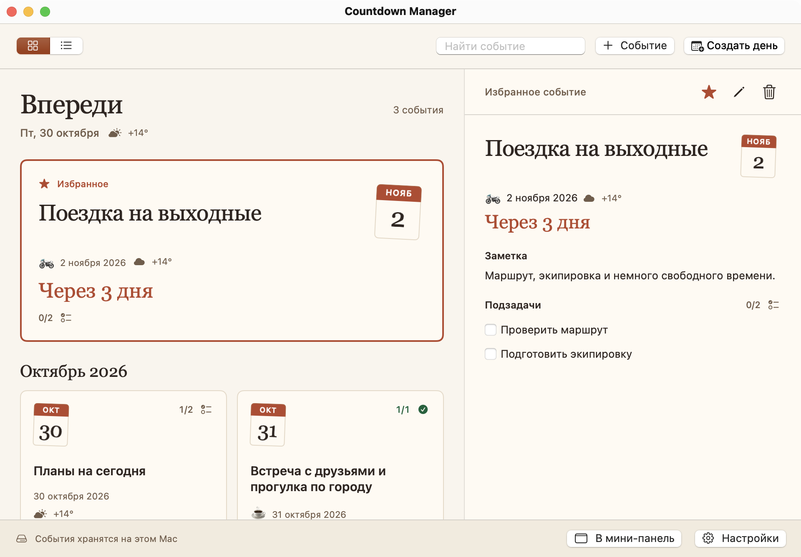
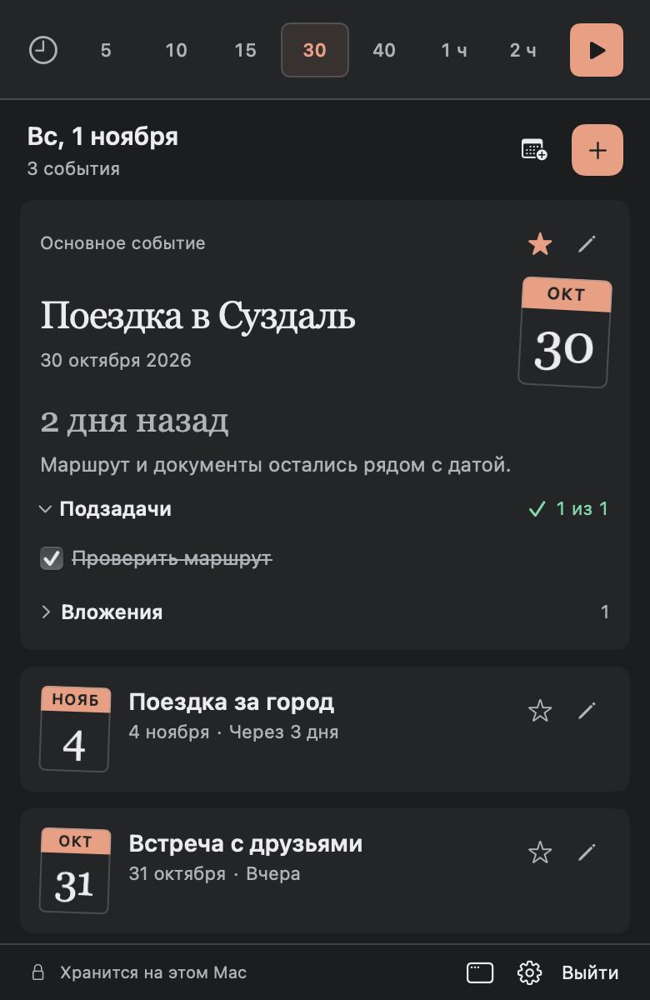
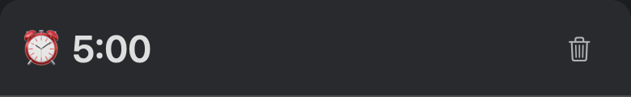

# Countdown Manager

Нативное приложение для macOS: события с датой, обратный отсчёт и небольшой список дел
для подготовки. Большое окно и мини-панель в строке меню работают с одними данными.
Учётная запись не нужна. События, файлы, ссылки и таймер доступны без интернета;
опциональный прогноз погоды требует сети.

**Опубликована 1.20.3 · сборка 39 · Apple Silicon · macOS 13+.**
Исправлено обрезание значка будильника у работающего и завершённого таймера.

[Последний опубликованный релиз](https://github.com/VDevGushin/CountdownManager/releases/latest) ·
[Проверки 1.20.3](docs/releases/v1.20.3.md) · [Что нового](docs/releases/v1.20.3-notes.md)

[Скачать CountdownManager-1.20.3-39.zip](https://github.com/VDevGushin/CountdownManager/releases/download/v1.20.3/CountdownManager-1.20.3-39.zip).
Публичный ZIP и оба appcast проверены без авторизации: HTTP 200 и точные SHA-256.

## Как выглядит приложение

Текущая тёмная тема — **графитовая**: нейтральные фоны и светлый текст, коралловые
календари и цвета состояний. Светлая тема использует тёплую бумажную палитру.
Можно выбрать светлый, тёмный или системный режим; повышенный контраст и уменьшение
движения учитываются отдельно. Календарь и файловые диалоги macOS могут сохранять
системное тонирование цветами обоев.

Нативные снимки **1.20.3/39**, полученные на изолированных демонстрационных данных:





Исправленный таймер:



[Происхождение снимков и границы проверок](docs/images/v1.20.3/PROVENANCE.md).

## Установка и обновления

Публичная сборка рассчитана на Mac с Apple Silicon и macOS 13 или новее.
Откройте [последний релиз](https://github.com/VDevGushin/CountdownManager/releases/latest),
скачайте ZIP, распакуйте и перенесите `Countdown Manager.app` в «Программы».
Сборка подписана ad-hoc, без нотарификации Apple; при первом запуске может потребоваться
разрешение в «Системные настройки → Конфиденциальность и безопасность».

В установленном приложении: **Настройки → Проверить обновления…**. Автопроверку можно
выключить, сохранив ручную. ZIP и канал Sparkle подписываются Ed25519; приложение
проверяет подпись до распаковки. Редактор, работающий таймер и незавершённая запись
откладывают перезапуск. «Вернуться к работе» сохраняет сеанс; установка готового
обновления запускается отдельной командой после повторной проверки.

Если вы обновляетесь именно с **1.20.0** и установка не завершается, закройте настройки
большого окна либо начните обновление из мини-панели. Этот дефект исправлен в 1.20.1.
Открыть описание текущего выпуска снова: **Настройки → Что нового…**.

## Быстрый старт

1. Нажмите значок Марса в строке меню. В пустом списке выберите **«На сегодня»**,
   **«На завтра»** или **«Выбрать дату»**; для обычного события нажмите **+**.
2. Укажите название и сегодняшнюю или будущую дату. При желании добавьте заметку,
   значок, подзадачи, файлы и ссылки, затем нажмите **«Сохранить»**.
3. Нажмите звезду, чтобы сделать событие основным. Оно появится первым и займёт строку
   меню. Повторное нажатие снимает выбор; без основного все карточки обычные,
   а в строке меню остаётся Марс.
4. Кнопка окна внизу мини-панели открывает большое окно. Доступно также меню
   **Окно → Открыть основное окно** (`Command-0`).

Мини-панель скрывается при переходе в другое приложение или Space. Повторный клик
возвращает тот же список или черновик с сохранённой позицией. `Command-W` скрывает
панель; выход из приложения может сбросить несохранённый черновик. После первого
открытия большого окна значок Dock остаётся до выхода из приложения.

## События и дни

- Несколько событий на одну дату разрешены. Дни считаются по календарю, а не по 24 часам.
- Карточка показывает точную дату и **«Сегодня»**, **«Завтра»**, **«Через N дней»**;
  у сохранённых прошедших событий — **«Вчера»** или **«N дней назад»**.
- В большом окне есть сетка, лента, поиск и детали. События сгруппированы по месяцу
  и году; прошедшие находятся после будущих, а выбранное основное остаётся первым.
- Действие **«Создать день»** заполняет название днём недели. Пока включено
  **«Название по дате»**, перенос даты обновляет его даже после сохранения.
  Ручной ввод включает своё название; действие рядом с полем возвращает автоматическое.
- Новая заметка — до 150 пользовательских символов. Старые длинные заметки сохраняются
  без обрезания; после сокращения действует новый сохранённый предел.
- Дополнительный значок выбирается из встроенного каталога и может быть очищен.
  Старый календарный emoji не дублирует календарный листок в карточках.

По умолчанию событие удаляется после окончания своей даты вместе с подзадачами,
ссылками и принадлежащими приложению копиями файлов. Флажок **«Сохранять после даты
события»** оставляет всё это доступным. Звезда сама по себе сохранение не включает.
Снятие флажка у уже прошедшего события требует подтверждения удаления.
Исходные файлы вне хранилища приложения не удаляются.

Изменения редактора записываются только после **«Сохранить»**; **«Отмена»** отбрасывает
черновик. Общий редактор может быть открыт только на одной из двух поверхностей.

## Подзадачи и материалы

На событие можно создать до **10 подзадач** и добавить до **15 файлов**.
Чек-лист показывает прогресс, группирует незавершённые дела перед выполненными и
помнит свёрнутое состояние. Выполнение всех дел не удаляет событие и не меняет дату.

Файлы можно выбрать в редакторе либо перетащить на событие. Для мини-панели поднесите
материал к значку в строке меню, дождитесь открытия панели и бросьте его на событие.
Приложение создаёт локальные копии, не перемещая исходники. Первые файлы видны на
полке превью; **«Показать все N»** открывает список с поиском.

Клик по файлу открывает встроенный нативный просмотр. Кнопки и клавиши **← / →**
переключают все файлы события без зацикливания. **«Открыть в приложении»** передаёт
файл системному приложению. Доступность превью зависит от формата и macOS;
видео автоматически не воспроизводится.

Веб-ссылки можно сохранить отдельно от файлов. Текст из буфера вставляется через
контекстное меню **«Вставить текст как вложение…»**: перед созданием TXT можно
проверить текст и имя. Исходный файл вне хранилища приложения при этом не удаляется.

## Таймер и строка меню

В приложении один таймер: **5, 10, 15, 30, 40, 60 или 120 минут**. Он находится
над событиями в мини-панели; состояние общее для обоих интерфейсов.
Во время отсчёта доступны остаток времени и удаление. Паузы и продления нет.

Завершение сопровождается звуком и собственным окном приложения на пять секунд;
клик закрывает окно без удаления завершённого таймера. В строке меню будильник
продолжает сигнализировать до удаления. «Уменьшение движения» заменяет покачивание
пульсацией, а значок в окне завершения делает неподвижным.
Абсолютный срок сохраняется между запусками.

Таймер временно занимает строку меню. После удаления возвращается основное событие
со своим значком или монохромным календарём и отсчётом; без основного — Марс без текста.

## Настройки и погода

Настройки доступны из обоих интерфейсов. Здесь находятся оформление, автозапуск,
автопроверка обновлений, погода, режим **«Не давать Mac и экрану засыпать»**,
проверка обновлений, **«Что нового…»** и **«Сохранить диагностику…»**.
Внизу отображается версия запущенного приложения.

Режим без сна сохраняет выбранное состояние между запусками и действует, пока
приложение работает. Он не отменяет ручной сон, блокировку, закрытие крышки или
защиту при низком заряде. При ошибке macOS интерфейс предлагает повторить действие.

Для прогноза включите **«Показывать погоду в днях»**, выберите автоматическое
местоположение или город, затем включите **«Показывать погоду для этого дня»**
у нужного события. У нового дня этот флажок уже включён. Геолокация запрашивается
при явном действии; при её недоступности можно выбрать город вручную.

Open-Meteo, MET Norway и wttr.is запрашиваются параллельно. Показывается медиана
пригодных дневных максимумов в °C; горизонт запроса — до 16 дней, включая сегодня.
Если на дату нет пригодного прогноза, погодного элемента просто нет. Временные ошибки
вызывают ограниченные повторные попытки. Доступность сервисов и работа через любой
VPN не гарантируются; прогноз и координаты удерживаются в памяти без дискового кэша.

## Данные и диагностика

События хранятся локально:

```text
~/Library/Application Support/CountdownManager/countdowns.json
```

Копии файлов находятся в `Attachments` рядом с JSON. Настройки, в том числе срок
таймера, сохраняются отдельно. Для резервной копии сохраняйте JSON и каталог
вложений вместе. Более старые версии могут потерять новые поля при записи;
откат не равнозначен совместимому чтению.

Погода отправляет координаты поставщикам прогноза; данные событий и файлы им
не передаются. Автообновление обращается к GitHub. Учётной записи и облачной
синхронизации событий у приложения нет.

**«Сохранить диагностику…»** создаёт локальный ZIP с технической сводкой и журналами.
Названия событий, заметки, тексты подзадач, пользовательские URL и координаты в него
не включаются. Отправка остаётся ручной. Журнал находится в каталоге `Logs` рядом
с данными; текущая и предыдущая части ограничены 512 КиБ каждая.

## Сборка и проверки

Нужны Git и Apple Command Line Tools либо Xcode.

```sh
git clone https://github.com/VDevGushin/CountdownManager.git
cd CountdownManager
./build.sh
open "Countdown Manager.app"
```

Сборка идёт под архитектуру текущего Mac. Обычный `build.sh` создаёт локально
подписанное приложение с выключенным автообновлением; подписанный канал задаётся
при подготовке релиза.

```sh
swiftlint lint --config .swiftlint.yml --strict --no-cache
./verify.sh fast       # CoreChecks, UIChecks и контракт оформления
./verify.sh ui         # мини-панель, редактор и сохранение сеанса
./verify.sh desktop    # большое окно и общее состояние
./verify.sh attachments
./run-xcui-tests.sh    # внешний macOS XCUITest; нужен полный Xcode
```

Выбирайте проверки по изменённому поведению, а не по количеству прогонов.
Нативные сценарии работают на отдельных профилях без пользовательских данных.
Снимки подтверждают вид, но не заменяют проверку системных взаимодействий.

## Документация проекта

- [PRODUCT](docs/PRODUCT.md) — поведение и ограничения продукта.
- [DESIGN](DESIGN.md) — текущий нативный визуальный язык.
- [ARCHITECTURE](docs/ARCHITECTURE.md) — устройство и владельцы состояния.
- [VERIFICATION](docs/VERIFICATION.md) — команды проверок и границы доказательств.
- [UPDATES](docs/UPDATES.md) — подготовка и публикация подписанного обновления.
- [AGENTS](AGENTS.md) — правила работы в репозитории и проектные навыки.
- [Countdown Release](.agents/skills/countdown-release/SKILL.md) — единый порядок выпуска и завершения релиза.
- [Agent evals](evals/README.md) — отдельные проверки поведения агента.
