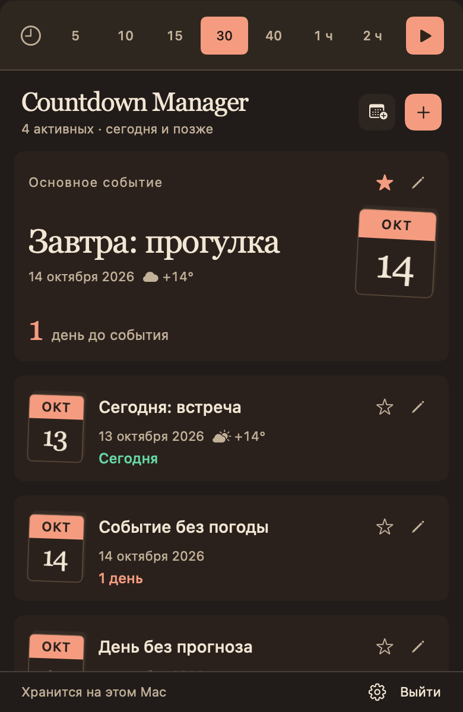
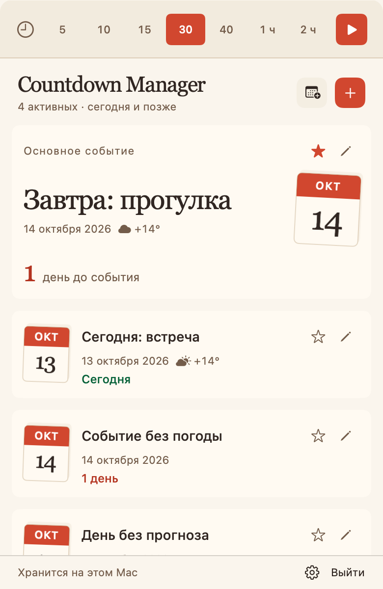
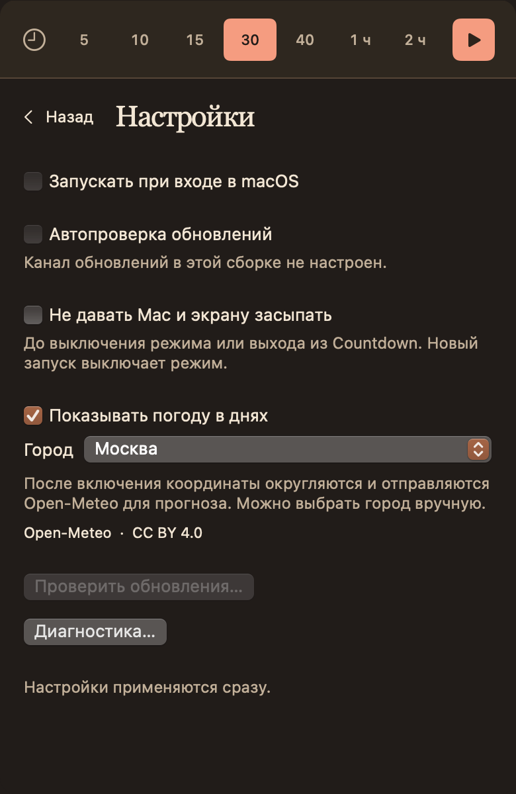
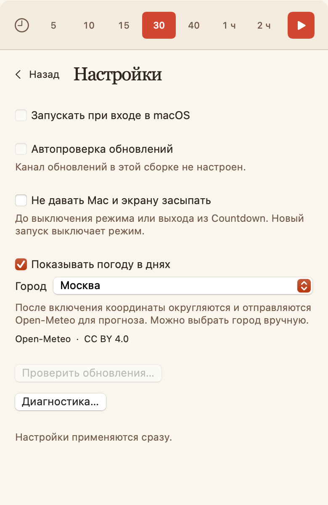
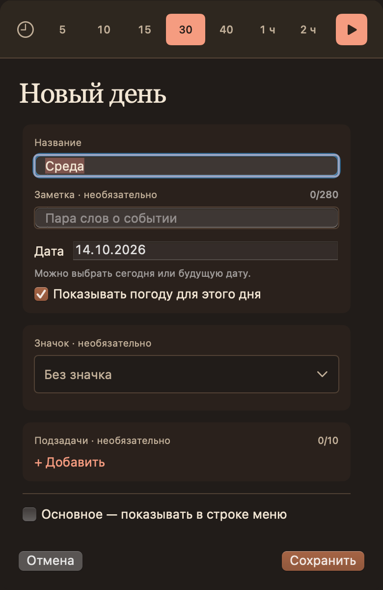
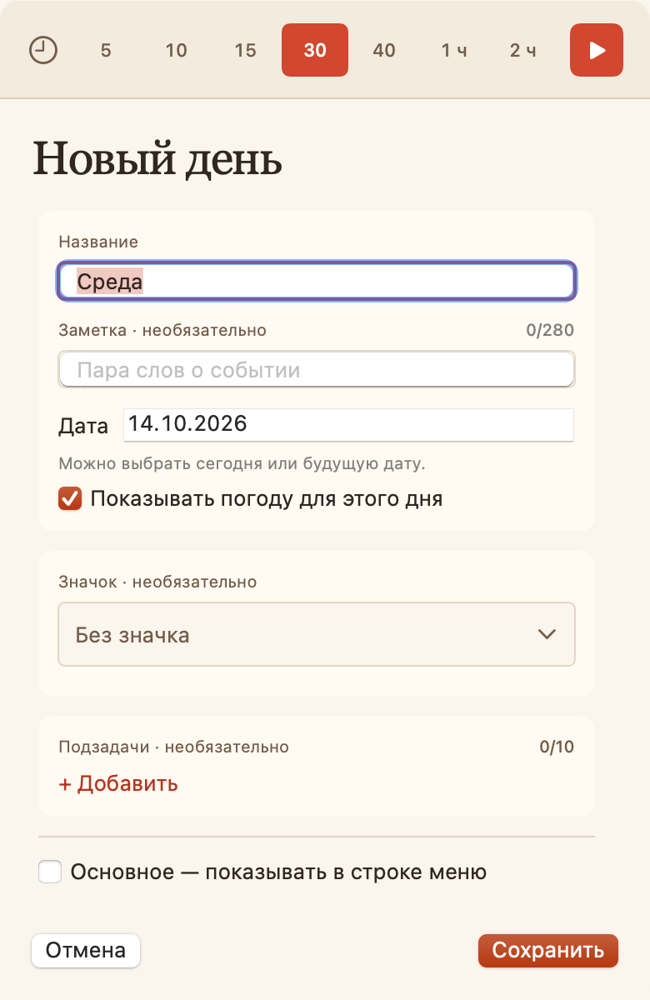
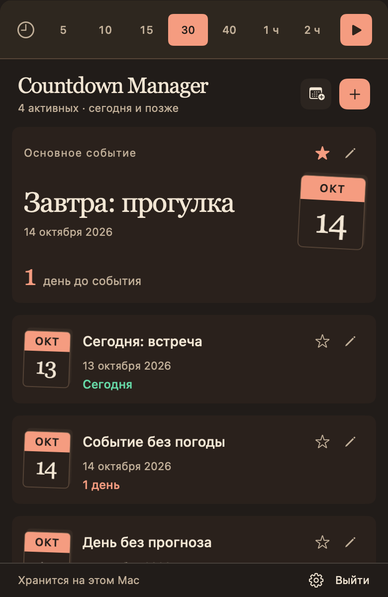
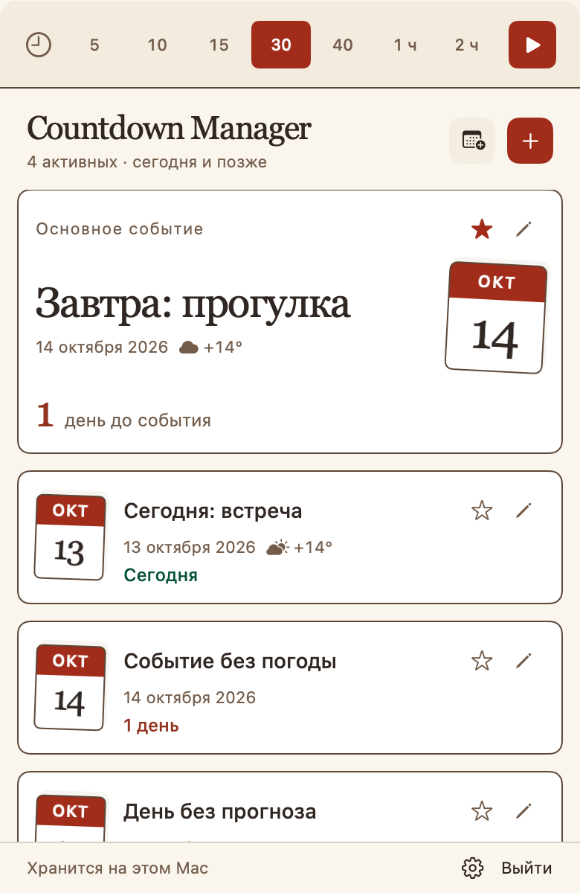

# Countdown Manager

Countdown Manager — компактное нативное приложение для строки меню macOS. Оно помогает ждать отпуск, день рождения, поездку или другое будущее событие и показывает, сколько календарных дней до него осталось. Это не todo-manager: дата события остаётся главной, а небольшой чек-лист лишь помогает подготовиться. Дополнительно в приложении есть один лёгкий таймер для коротких напоминаний по времени.

Учётная запись и разрешение на уведомления не требуются. События, подзадачи и таймер
работают без интернета; опциональный прогноз погоды требует подключения к сети.

Текущая опубликованная версия — **1.9.0, сборка 16** с погодой рядом с датой дня.
Реализация, автоматические проверки и изолированные нативные погодные сценарии приняты;
галерея визуально проверена. Разрешённая проверка отдельного нативного адаптера вернула
«местоположение недоступно»; успешный AUTO, системное окно разрешения, VPN и внешние
физические взаимодействия не подтверждены. Подробный статус — в
[заметках к версии 1.9.0](docs/releases/v1.9.0.md).
ZIP и лента обновлений 1.9.0 подписаны Ed25519 и опубликованы; их анонимная доступность
по HTTPS и совпадение хешей проверены. Локальная установка **1.9.0, сборка 16**
и завершённый запуск из «Программ» подтверждены.

## Интерфейс

Восемь свежих нативных снимков погодного интерфейса **1.9.0, сборка 16**
с изолированными демонстрационными событиями. Погодные значения **+14°C** подставлены
для проверки интерфейса; для одной даты данные специально отсутствуют. При захвате
не было погодных HTTP-запросов или реальной геолокации. Это не актуальный прогноз.

В локальной сборке для захвата канал обновлений не настроен, поэтому соответствующие
элементы настроек недоступны. Релизная сборка использует канал Sparkle. Происхождение
и хеши снимков записаны в [capture-provenance.json](docs/images/v1.9.0/capture-provenance.json).
Исторические изображения [1.8.1](docs/images/v1.8.1/) сохранены отдельно.

### События в тёмной и светлой теме




### Настройки в той же панели

Флажок **«Показывать погоду в днях»**, выбор города и ссылки на источник и лицензию
находятся на экране настроек. «Назад» возвращает к событиям; таймер остаётся сверху.




### Выбор погоды для дня в редакторе

Новый день начинается с включённым флажком **«Показывать погоду для этого дня»**.
Изменение вступает в силу после сохранения; общая настройка погоды остаётся независимой.




<details>
<summary>Выключенная погода и повышенный контраст</summary>




</details>

## Установка готового приложения

Готовая публичная сборка рассчитана на Mac с Apple Silicon и macOS 13 или новее.

1. Откройте страницу [выпуска 1.9.0](https://github.com/VDevGushin/CountdownManager/releases/tag/v1.9.0).
2. Скачайте [ZIP-архив 1.9.0, сборка 16](https://github.com/VDevGushin/CountdownManager/releases/download/v1.9.0/CountdownManager-1.9.0-16.zip) с `Countdown Manager.app` и распакуйте его.
3. Перенесите **Countdown Manager.app** в папку **«Программы»**.
4. При первом запуске нажмите приложение правой кнопкой мыши, выберите **«Открыть»** и подтвердите запуск.

Приложение пока подписано локальной ad-hoc подписью и не нотарифицировано Apple. Поэтому обычный двойной клик при первом запуске может быть заблокирован. Если команда **«Открыть»** не помогла, откройте **«Системные настройки» → «Конфиденциальность и безопасность»** и разрешите запуск приложения там.

Если на странице Releases ещё нет готового архива или используется Intel Mac, приложение можно [собрать из исходников](#сборка-из-исходников).

## Обновления приложения

Релизная сборка использует подписанный канал Sparkle. Начиная с 1.8.0,
**«Проверить обновления…»** и **«Автопроверка обновлений»** находятся на экране настроек;
в 1.7.0 они расположены внизу основной панели. Ручная проверка также есть в меню приложения.
Автопроверку можно выключить, сохранив ручную проверку. Установку предлагает стандартное окно
Sparkle. Перед его показом основная панель скрывается, чтобы кнопки обновления были доступны.
Повторный клик по строке меню возвращает тот же редактор и таймер.

Перезапуск ждёт закрытия редактора, завершения записи данных и окончания работающего таймера.
Если установка отложена, нажмите **«Вернуться к работе»**, завершите редактирование или таймер,
затем **«Обновление готово · установить…»**. Эта кнопка заменяет ручную проверку
на экране настроек. Приложение повторно проверит безопасность перезапуска; завершение работы
с редактором или таймером само не запускает установку.

Версии без Sparkle, включая 1.6.0, требуют **одной ручной установки 1.9.0** из
[Releases](https://github.com/VDevGushin/CountdownManager/releases/tag/v1.9.0), чтобы перейти на версии
со встроенными обновлениями. Обычная локальная сборка не обращается к серверу обновлений.
События и таймер работают без интернета. Платный аккаунт Apple для схемы ad-hoc + Ed25519
не нужен; условия первого запуска через Gatekeeper сохраняются.

Стабильный канал обновлений — [подписанный appcast](https://github.com/VDevGushin/CountdownManager/releases/latest/download/appcast.xml).
Порядок настройки ключа, сборки и подготовки подписанного выпуска — в [docs/UPDATES.md](docs/UPDATES.md).

## Как пользоваться

После запуска в строке меню появится **◷ Countdown**; отдельной иконки в Dock нет.

1. Нажмите **◷ Countdown**, затем **+ Добавить событие**.
2. Укажите название и сегодняшнюю или будущую дату. При желании добавьте заметку до 280 символов и подзадачи. Значок необязателен: новый черновик начинается с **«Без значка»**.
3. Для выбора значка нажмите поле **«Значок · необязательно»**. Оно раскроет восемь быстрых вариантов; **«Все значки»** открывает каталог из пяти наборов — **«Общие»**, **«Дети»**, **«Работа»**, **«Транспорт»** и **«Праздники»**. Переключайтесь стрелками, точками или горизонтальным свайпом. Выбор закрывает палитру; маленькая **×** внутри поля убирает значок.
4. Нажмите **«Сохранить»**. Если основное событие не выбрано, строка меню и крупная карточка покажут ближайшее событие, начиная с сегодняшнего дня. Первое сохранение не заполняет звезду автоматически.
5. Чтобы закрепить событие как основное, нажмите его пустую звезду. Повторное нажатие на заполненную звезду снимает выбор. Отметку **«Основное — показывать в строке меню»** также можно включить или снять в редакторе и сохранить.
6. Карандаш открывает редактор события: подзадачи, значок и удаление с подтверждением доступны в одном месте.

Редактор разделён на три блока: название, заметка и дата; значок; подзадачи. Выбор основного события расположен ниже, а **«Сохранить»** и **«Отмена»** остаются внизу панели при прокрутке формы. Интерфейс использует тёплую светлую и тёмную палитры и учитывает системное повышение контраста.

Изменения редактора попадают в данные только после **«Сохранить»**. **«Отмена»** отбрасывает черновик. Нажатие строки меню открывает под ней компактную панель без стрелки, заголовка и оконных кнопок на текущем Space; панель нельзя перемещать. **Command-W**, переход в другое приложение или на другой Space скрывают панель, сохраняя в памяти позицию списка, открытый редактор и введённый текст. Возврат на прежний Space сам её не показывает: новый клик по строке меню возвращает тот же сеанс, а если панель уже видна — скрывает её. Выход из приложения может сбросить несохранённые черновики.

Для планов на день нажмите кнопку с календарём **«Создать день»** рядом с **+**, затем выберите **«Сегодня»**, **«Завтра»** или **«Выбрать дату»**. Откроется тот же редактор с выбранной датой и названием дня недели, например **«Понедельник»**; выбор произвольной даты начинается с завтрашней. Дополнительный значок не выбран, заметка и список дел пустые. Измените поле **«Дата»**: название дня обновится автоматически, пока вы сами его не измените. После ручного изменения названия оно сохраняется при смене даты. Для сегодняшнего дня редактор предупреждает, что событие и незавершённые подзадачи будут удалены после окончания дня. Остальные поля тоже можно менять.

День появляется в списке только после **«Сохранить»** и работает как обычное событие; несколько событий на одну дату разрешены. Повторное действие создания при открытом редакторе не заменяет его черновик. Создание недели и библиотека сохранённых шаблонов пока не предусмотрены.

В версии 1.9.0 у нового дня включён флажок **«Показывать погоду для этого дня»**.
В обычном новом событии через **+** и у ранее сохранённых событий он выключен.
Его можно изменить в редакторе любого события, в том числе добавить погоду старому дню,
и сохранить. Приложение не определяет дни автоматически по названию или дате.
Для самого прогноза также требуется включить погоду в общих настройках.

Над списком событий размещена полоса одного таймера: выберите фиксированную длительность и запустите её — подробности в разделе [«Таймер»](#таймер).

## Настройки и режим без сна

Нажмите маленькую шестерёнку слева от **«Выйти»** в нижней строке основной панели.
Откроется экран настроек внутри той же компактной панели; таймер остаётся сверху.
В заголовке списка сохранены кнопки календаря и **+**. Настройки применяются сразу;
**«Назад»** возвращает список с прежней позицией прокрутки. Скрытие и повторное открытие панели
сохраняют текущий экран. Вход в настройки доступен из списка и не заменяет открытый редактор.

Сначала идут три флажка: **«Запускать при входе в macOS»**, **«Автопроверка обновлений»** и
**«Не давать Mac и экрану засыпать»**. В версии 1.9.0 далее находится
**«Показывать погоду в днях»** с выбором местоположения; ниже — кнопки проверки обновлений
и диагностики.
Автозапуск по умолчанию выключен. Если macOS требует разрешения, появляется
**«Разрешить в настройках macOS…»**. В обычной локальной сборке без настроенного канала
обновлений соответствующие элементы недоступны.

Режим **«Не давать Mac и экрану засыпать»** удерживает компьютер и экран от автоматического
сна при бездействии, пока приложение работает. Он сохраняется при скрытии панели, переходе
назад и действиях таймера; маленькая точка на шестерёнке показывает его включённое состояние
в списке. Выключение флажка или выход из Countdown снимает удержание. Каждый новый запуск,
в том числе после обновления или входа в macOS, начинает с выключенного режима.

Состояние флажка меняется после успешного ответа macOS. При ошибке включения он остаётся
выключенным; при ошибке выключения остаётся включённым, а сообщение позволяет повторить попытку.
Режим не меняет постоянные настройки питания или безопасности и не обращается к сети.
Он не отменяет экранную заставку, блокировку с паролем, сон при закрытии крышки, ручной сон
или сон из-за низкого заряда и не пробуждает уже спящий экран.

## Погода в днях

Погода доступна начиная с версии 1.9.0 и включается по желанию пользователя.

1. Откройте настройки и включите **«Показывать погоду в днях»**. При первом запуске
   функция выключена; её состояние и выбор местоположения сохраняются между запусками.
2. Оставьте **«Автоматически»** для определения местоположения через macOS или выберите город
   вручную. Ручной список: Москва, Санкт-Петербург, Казань, Грозный, Нижний Новгород,
   Екатеринбург, Новосибирск, Самара, Ростов-на-Дону, Краснодар.
3. Создайте день через календарь или откройте существующее событие, включите
   **«Показывать погоду для этого дня»** и сохраните.

Рядом с датой появляется значок состояния погоды и округлённая максимальная температура
за день в °C. Это дневной прогноз, а не температура сейчас. Подсказка при наведении
объясняет значение и указывает Open-Meteo; погодный элемент ведёт на сайт источника.
Подробная погодная панель с ветром, осадками и температурой по ощущениям в эту версию не входит.

Приложение запрашивает прогноз максимум на 16 календарных дней, включая сегодня.
Если пригодных данных на дату нет или погода выключена, в карточке просто нет погодного
элемента: без загрузки, ошибки, заглушки и кнопки повтора. Настройки также не показывают
загрузку или ошибку получения прогноза.
Список событий продолжает работать. Для AUTO требуется доступ к геолокации macOS;
если местоположение получить нельзя, выберите город в настройках.

Когда разрешение ещё не выдано, его запрос связан с явным действием: включением погоды,
выбором AUTO или успешным сохранением подходящего дня с погодой в открытом приложении.
Можно сначала включить общую настройку, а затем создать день. Отмена, неудачное сохранение
и восстановление списка после запуска сами не запрашивают разрешение.

Источник — [Open-Meteo](https://open-meteo.com/).
Используются дневные `weather_code` и `temperature_2m_max` из
[Forecast API](https://open-meteo.com/en/docs); температура округляется до целого градуса,
а погодный код переводится в значок и русское описание.
Данные предоставляются по [CC BY 4.0](https://open-meteo.com/en/licence).
Бесплатный API допускает некоммерческое использование согласно
[условиям Open-Meteo](https://open-meteo.com/en/terms); учётная запись, API-ключ
и платный аккаунт Apple для этого варианта не нужны.

## События и карточки

- Событий может быть сколько угодно, в том числе несколько на одну дату.
- У каждого события есть календарный листок с его настоящим месяцем и числом без ведущего нуля, название, полная дата и отсчёт. Дополнительный значок отображается перед звездой, если выбран; заметка — если заполнена. Старый **📅** в списке не дублирует календарный листок, но остаётся в редакторе и данных.
- Крупная карточка показывает выбранное основное событие или ближайшее событие, если выбор снят. Её календарь находится справа; у остальных событий — слева. Карточки и их чек-листы объединены на мягких отдельных поверхностях.
- В дату события карточка и строка меню показывают `Сегодня`. Такое событие остаётся доступным весь календарный день: его можно редактировать, удалять, оставлять на сегодняшней дате или переносить в будущее.
- Новое событие можно создать на сегодня или будущую дату. Прошлые даты недоступны.
- Выбранное основное событие стоит первым. Без выбора список начинается с ближайшей даты, включая сегодня, и крупная карточка называется **«Ближайшее событие»**. Автоматическое отображение не сохраняет выбор звезды. События одной даты сохраняют исходный порядок независимо от названий.
- После окончания даты событие автоматически удаляется без архива. Незавершённые подзадачи не задерживают удаление; просроченных событий и автоматического переноса в продукте нет.
- Если выбранное основное событие удаляется или истекает, выбор снимается и приложение автоматически показывает ближайшее оставшееся событие. При равной дате используется стабильный пользовательский порядок.

Когда событий нет, панель показывает короткое пустое состояние; новое событие можно создать кнопкой **+** в верхней части панели. Строка меню при этом показывает **◷ Countdown**.

## Подзадачи

У события может быть от 0 до 10 коротких подзадач. Каждая содержит только текст до 50 символов и состояние выполнения — без собственной даты, времени, приоритета, напоминания или вложенности. Подзадачи можно добавить сразу при создании события либо позже в редакторе события; состояние выполнения меняется в карточке события. В редакторе текст подзадачи по-прежнему редактируется как текст.

Нажать можно на любую часть строки подзадачи: флажок, текст или пустое место
справа. Одно нажатие меняет состояние один раз: незавершённая подзадача отмечается выполненной,
а выполненная возвращается в работу.

- Выполненная подзадача остаётся видимой, зачёркивается и показывается ниже невыполненных. Её текст и отметка становятся спокойнее; строки чек-листа разделяются отступами, без горизонтальных линий. Внутри обеих групп сохраняется исходный пользовательский порядок.
- Повторное нажатие снимает отметку: подзадача снова вернётся в группу невыполненных.
- Индикатор `▸ 2/8` или `▾ 2/8` показывает количество выполненных и общее количество. Раскрытие и сворачивание занимают 200 мс; состояние хранится отдельно для каждого события и восстанавливается после перезапуска.
- Добавление и удаление строк в редакторе сопровождаются коротким переходом 100 мс. Ввод текста не анимируется. При системном **«Уменьшении движения»** переходы происходят сразу.
- Если подзадач нет, блок и индикатор не показываются — значения `0/0` в интерфейсе нет.
- `10/10` не завершает и не удаляет событие досрочно. Оно продолжает жить до своей календарной даты.
- Длинный текст в карточке занимает одну строку, сокращается многоточием, а полный текст доступен в подсказке при наведении.

Уведомлений и напоминаний по событиям и подзадачам нет.

## Таймер

Помимо событий, в приложении есть ровно один таймер для коротких напоминаний — без названия и текста задачи.

- Когда таймер простаивает, выберите одну из семи фиксированных длительностей — 5, 10, 15, 30, 40, 60 или 120 минут — и запустите его. Произвольная длительность не предусмотрена.
- Пока таймер идёт, панель показывает `⏰` и остаток времени. Поставить на паузу, изменить или продлить длительность нельзя; единственное действие таймера — удалить его.
- Таймер хранит абсолютный момент окончания: закрытие панели, выход и повторный запуск приложения, сон Mac и обычный ход часов его не сбрасывают. Время, проведённое вне приложения, тоже идёт.
- Когда время истекает, таймер переходит в состояние `⏰ Время вышло` и остаётся в нём до удаления: играет встроенный звук, на пять секунд появляется собственное окно приложения поверх остальных окон. Оно оформлено в палитре приложения и не перехватывает фокус. Нажатие в любом месте сразу закрывает окно, сохраняя завершённый таймер.
- В окне завершения двигается только значок будильника: короткие наклоны и небольшие подъёмы чередуются с паузой. Текст и карточка неподвижны. При **«Уменьшении движения»** этот значок статичен.
- Отдельный значок будильника в строке меню продолжает покачиваться до удаления завершённого таймера; при **«Уменьшении движения»** он пульсирует.
- Это не системное уведомление: приложение не запрашивает разрешение на уведомления macOS. Если приложение не работало в момент окончания, после запуска просто восстановится состояние «время вышло» — без повторного звука и окна.
- Таймер не связан с событиями и подзадачами и не создаёт их.

## Строка меню

В строке меню отображается выбранное основное событие, а если выбор снят — ближайшее активное, включая сегодняшнее. Формат — значок и отсчёт, например `☀️ 1 день` или `☀️ Сегодня`; при пустом дополнительном значке используется **📅**. Название, дата, заметка, checkbox и прогресс подзадач туда не попадают. Если событий нет, отображается `◷ Countdown`.

Пока таймер работает, его показание временно занимает строку меню: `⏰ 29:59`, а после завершения — просто `⏰`, пока таймер не удалён. Удаление таймера возвращает отображение выбранного основного или ближайшего события.

## Данные и приватность

Все события и подзадачи хранятся только на текущем Mac в файле:

`~/Library/Application Support/CountdownManager/countdowns.json`

Старый JSON без поля `subtasks` полностью совместим и читается как событие без подзадач. Существующие идентификаторы, названия, заметки, даты, emoji и действующий выбор основного события сохраняются. Отсутствие дополнительного значка и снятый выбор основного события тоже сохраняются после перезапуска. Некорректный пользовательский JSON не исправляется и не перезаписывается молча: приложение оставляет файл без изменений и сообщает об ошибке.

В версии 1.9.0 выбор погоды для события хранится вместе с ним. Старые данные без поля
`showsWeather` читаются с выключенной погодой; автоматической миграции или распознавания дней нет.
Общие погодные настройки хранятся локально отдельно от событий.

После включения погоды прогноз запрашивается по HTTPS у Open-Meteo для выбранной области.
В AUTO приложение запрашивает одно местоположение с желаемой точностью около 3 км;
перед отправкой координаты округляются до двух знаков после запятой. Желаемая точность
не гарантирует фактическую точность ответа macOS. В ручном режиме отправляются координаты города,
а геолокация Mac для этого запроса не нужна. Названия, заметки, подзадачи и идентификаторы событий
в погодный запрос не входят. Координаты и прогноз удерживаются в памяти, а не в файле событий.
Погодный сетевой сеанс не сохраняет дисковый кэш, cookies или учётные данные.
Выключение погоды прекращает запросы и убирает её из карточек.

По [политике Open-Meteo](https://open-meteo.com/en/terms#privacy) сервис может хранить
IP-адрес и координаты запроса в технических журналах до 90 дней. Системное разрешение
на геолокацию контролирует macOS; см.
[документацию Apple о разрешениях](https://developer.apple.com/documentation/corelocation/requesting-authorization-to-use-location-services).
Отдельный нативный адаптер проверен один раз с согласия пользователя и вернул
`unavailable`: координаты не получены, погодных HTTP-запросов в этом стенде нет.
Начальная панель и нажатие запроса наблюдались, но чтение окна после запроса завершилось
тайм-аутом; системное окно разрешения не было замечено. Успешный AUTO, порядок выдачи
разрешения, VPN и полный путь получения погоды в приложении остаются неподтверждёнными.

Дни считаются по календарю, не делением секунд на 86400. Даты сохраняются как год/месяц/день; запись выполняется атомарно. Чтение, JSON-кодирование и запись происходят вне главного UI-потока. Последовательное хранилище и номера ревизий защищают новое состояние от запоздавшей записи, а неуспешное изменение откатывается в интерфейсе.

Состояние сворачивания чек-листов является отдельной настройкой интерфейса и не добавляется в `countdowns.json`.

## Диагностика

Приложение ведёт локальный журнал действий и ошибок:

`~/Library/Application Support/CountdownManager/Logs/countdown.log`

Когда файл достигает 512 КБ, предыдущая часть сохраняется как `countdown.previous.log`. Журнал содержит только технические факты: тип операции, UUID события или подзадачи, количество элементов, ревизию и результат. Названия, заметки, пользовательские emoji и текст подзадач никогда не записываются.

Если главный поток не отвечает 5 секунд, фоновый сторож добавляет `ui.stall detected`; после восстановления — `ui.stall recovered`. Папку можно открыть через кнопку **«Диагностика…»** на экране настроек; в прежней 1.7.0 она находилась внизу основной панели.

## Сборка из исходников

Нужны Git и Apple Command Line Tools (`xcode-select --install`) либо полный Xcode.

```sh
git clone https://github.com/VDevGushin/CountdownManager.git
cd CountdownManager
./build.sh
open "Countdown Manager.app"
```

Скрипт создаёт локально подписанный `Countdown Manager.app` в корне проекта. Сборка выполняется под архитектуру текущего Mac.

## Проверки для разработчиков

```sh
./verify.sh fast  # CoreChecks + UIChecks
./verify.sh ui    # release build + Real UI Smoke
./verify.sh full  # оба набора
./run-xcui-tests.sh  # настоящий macOS XCUITest, требуется полный Xcode
```

`CoreChecks` покрывает валидацию событий и подзадач, редактирование события `Сегодня`, жизненный цикл, стабильный порядок, legacy/new JSON round-trip и revision ordering. `UIChecks` использует тот же presentation/state-слой, что и SwiftUI, и детерминированно проверяет пользовательские строки, карточку, дату и отсчёт, чек-лист, collapse-state, быстрые операции, empty state и строку меню. `Real UI Smoke` запускает собранное приложение в изолированном профиле: проверяет lifetime hosting/root, сохранение позиции списка и draft через hide/show панели, быстрый выбор emoji, сохранение и отмену, а также многократный collapse/expand при одном и нескольких событиях.

XCUITest-набор использует минимальный `CountdownManager.xcodeproj`, собирает отдельную тестовую копию приложения и запускается из CLI без ручного открытия Xcode. Каждый тест работает с собственным временным Application Support-профилем и fixture-данными; production `countdowns.json`, UserDefaults и журналы не используются.

Подробная карта verification surfaces и правила выбора достаточного evidence находятся в [`docs/VERIFICATION.md`](docs/VERIFICATION.md).

## Управление проектом через ИИ

Репозиторий содержит небольшой agent harness для сопровождения Countdown Manager.

Поведение агента проверяется отдельным набором [evals](evals/README.md): точечные исправления,
ревью без изменений, выбор доказательств и соблюдение продуктовых границ. Запуски используют
отдельные копии проекта; результаты оцениваются по действиям, независимым проверкам и рубрике.

Для обычной работы владельцу не нужно писать техническое ТЗ или выбирать Swift, SwiftUI или AppKit API. Достаточно описать проблему, желаемый пользовательский результат и важные ограничения.

Примеры:

```text
Исправь баг: после закрытия и повторного открытия окна список возвращается наверх.
```

```text
Проведи engineering review проекта. Ничего не меняй.
```

```text
Проверь agent harness на лишнюю сложность, дублирование и устаревшие правила. Ничего не меняй.
```

Обычный bug fix не требует отдельного специального workflow. Агент сам выбирает технический путь и достаточный уровень verification в пределах правил репозитория.

Основные agent-инструкции находятся в [`AGENTS.md`](AGENTS.md).

Канонические repository knowledge surfaces:

- [`docs/PRODUCT.md`](docs/PRODUCT.md) — текущее пользовательское поведение и product invariants;
- [`docs/ARCHITECTURE.md`](docs/ARCHITECTURE.md) — карта текущей реализации и ownership;
- [`docs/VERIFICATION.md`](docs/VERIFICATION.md) — verification surfaces и выбор evidence;
- [`docs/decisions/`](docs/decisions/) — принятые durable technical decisions;
- [`.agents/skills/macos-platform-research/SKILL.md`](.agents/skills/macos-platform-research/SKILL.md) — специализированное исследование неопределённого macOS/SwiftUI/AppKit поведения.

Scope, user-data protection и authority boundaries определены только в `AGENTS.md`, чтобы README не становился второй копией agent policy.

Нативные API: [NSStatusBar](https://developer.apple.com/documentation/appkit/nsstatusbar), [SMAppService](https://developer.apple.com/documentation/servicemanagement/smappservice/mainapp).
