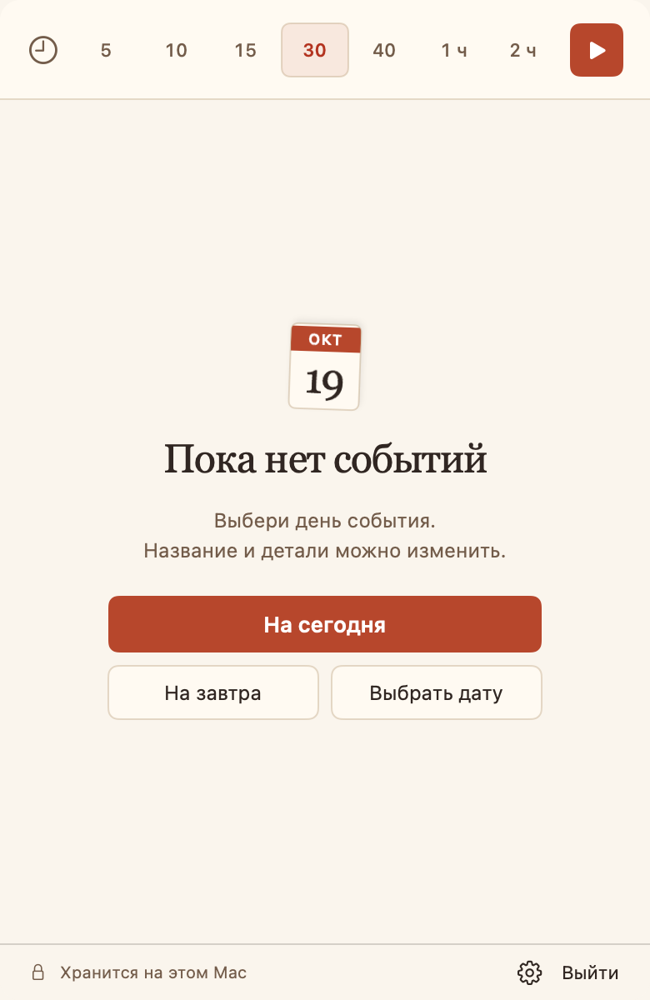
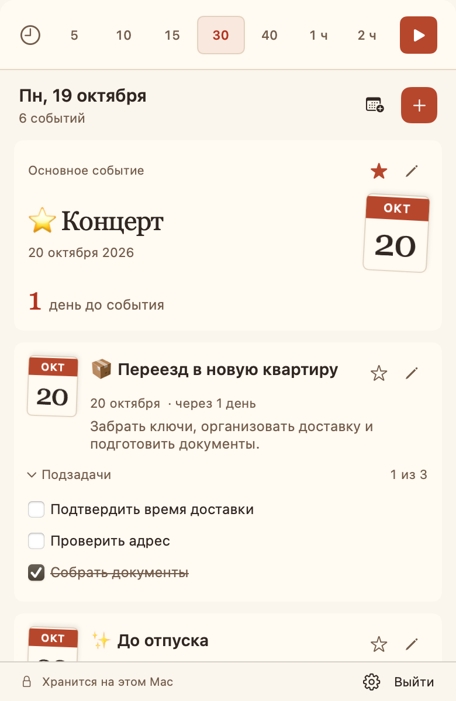
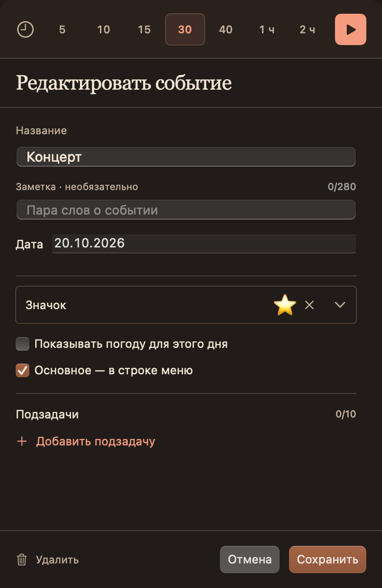
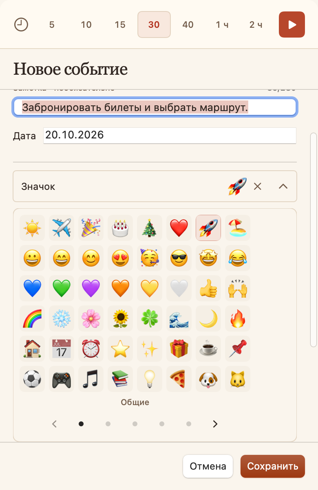
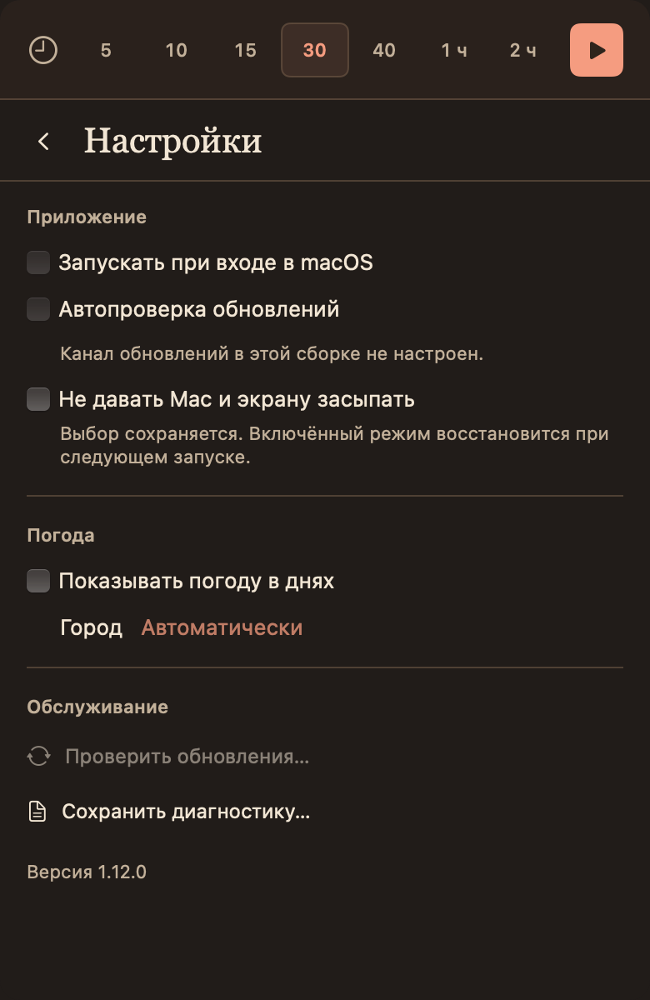
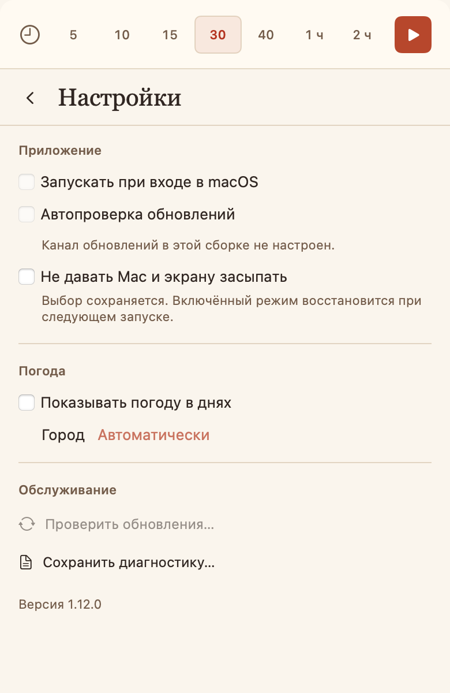
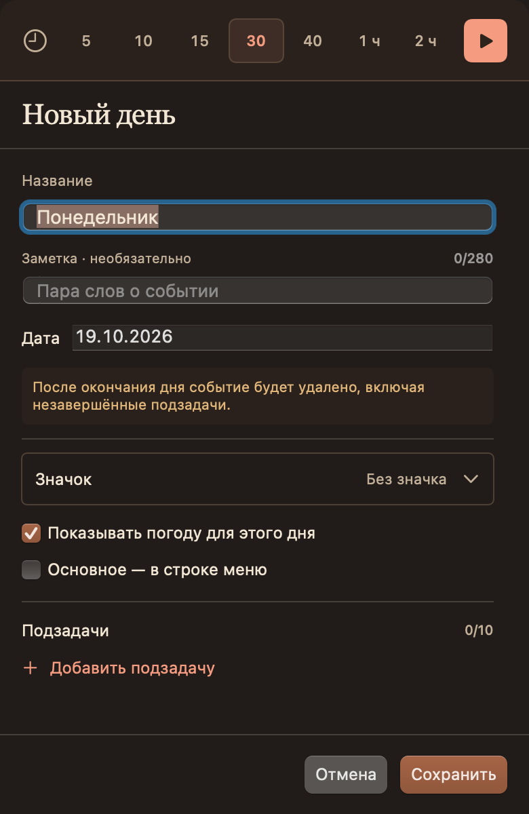

# Countdown Manager

Countdown Manager — компактное нативное приложение для строки меню macOS. Оно помогает ждать отпуск, день рождения, поездку или другое будущее событие и показывает, сколько календарных дней до него осталось. Это не todo-manager: дата события остаётся главной, а небольшой чек-лист лишь помогает подготовиться. Дополнительно в приложении есть один лёгкий таймер для коротких напоминаний по времени.

Учётная запись и разрешение на уведомления не требуются. События, подзадачи и таймер
работают без интернета; опциональный прогноз погоды требует подключения к сети.

Версия **1.12.0, сборка 21**: новый пустой экран с созданием дня на сегодня,
завтра или выбранную дату, автоматические названия дней недели и более устойчивое
получение погоды. Диагностика свежести и повторов работает через ограниченную
фоновую очередь и не ждёт диска на главном потоке.

Релизная сборка использует подписанный канал Sparkle. Приложение подписано ad-hoc,
ZIP и appcast — Ed25519. Выпуск опубликован как Latest и установлен в `/Applications`;
публичные скачивания и хеши проверены, события и настройки сохранились. Статус, проверки
и ограничения — в [заметках 1.12.0](docs/releases/v1.12.0.md).
Предыдущий опубликованный выпуск — [1.11.0](docs/releases/v1.11.0.md).
События и настройки не требуют миграции или сброса.

## Интерфейс

В версии **1.12.0** пустой список содержит три центральных действия:
**«На сегодня»**, **«На завтра»**, **«Выбрать дату»**. Они открывают «Новый день»
с названием по дню недели и включённой погодой для дня. При смене даты название
обновляется до первого ручного изменения; запись появляется только после «Сохранить».
До первого события вся шапка скрыта, таймер и футер остаются. После сохранения
возвращается обычный список; после удаления или истечения последнего события — пустой экран.
SwiftLint, CoreChecks/UIChecks и изолированный нативный сценарий пройдены.
Снимки 1.12.0 получены из релизной сборки с изолированными демонстрационными данными.
На снимке полуночи дата подставлена; исторические изображения прежних выпусков сохранены.




Происхождение, хеши и ограничения — в
[capture-provenance.json](docs/images/v1.12.0/empty-state/capture-provenance.json).

Ниже — нативные снимки версии **1.12.0, сборка 21**
с изолированными демонстрационными событиями. Панель сохраняет размер 390 × 600,
спокойный таймер сверху, календарные листки и светлую/тёмную палитры.
Изолированный режим отключает обновления и реальную геолокацию; системные настройки
Mac не менялись. Снимки не показывают актуальный прогноз.
Происхождение, результаты и хеши всех 31 снимка — в
[capture-provenance.json](docs/images/v1.12.0/capture-provenance.json).
Исторические изображения [1.11.0](docs/images/v1.11.0/), [1.10.1](docs/images/v1.10.1/), [1.10.0](docs/images/v1.10.0/),
[1.9.0](docs/images/v1.9.0/) и [1.8.1](docs/images/v1.8.1/) сохранены.

### Список событий




### Редактор и каталог значков

Название, заметка и подзадачи используют системную рамку и фокус без дополнительной обводки.
Поле **«Заметка · необязательно»** всегда видно сразу, с подсказкой
**«Пара слов о событии»** и счётчиком символов до 280. Поле значка отделено
от флажков; восемь быстрых вариантов и пять каталогов по 48 ячеек сохранены.
**«Удалить»**, **«Отмена»** и **«Сохранить»** находятся в закреплённой нижней полосе.




### Настройки

Группы **«Приложение»**, **«Погода»** и **«Обслуживание»**;
кнопка **«Сохранить диагностику…»** готовит ZIP для ручной отправки.




<details>
<summary>Пустой список и предупреждение для сегодняшнего дня</summary>




</details>

## Установка готового приложения

Готовая публичная сборка рассчитана на Mac с Apple Silicon и macOS 13 или новее.

1. Откройте страницу [выпуска 1.12.0](https://github.com/VDevGushin/CountdownManager/releases/tag/v1.12.0).
2. Скачайте [ZIP-архив 1.12.0, сборка 21](https://github.com/VDevGushin/CountdownManager/releases/download/v1.12.0/CountdownManager-1.12.0-21.zip) с `Countdown Manager.app` и распакуйте его.
3. Перенесите **Countdown Manager.app** в папку **«Программы»**.
4. При первом запуске нажмите приложение правой кнопкой мыши, выберите **«Открыть»** и подтвердите запуск.

Приложение пока подписано локальной ad-hoc подписью и не нотарифицировано Apple. Поэтому обычный двойной клик при первом запуске может быть заблокирован. Если команда **«Открыть»** не помогла, откройте **«Системные настройки» → «Конфиденциальность и безопасность»** и разрешите запуск приложения там.

Если на странице Releases ещё нет готового архива или используется Intel Mac, приложение можно [собрать из исходников](#сборка-из-исходников).

## Обновления приложения

Релизная сборка использует подписанный канал Sparkle. Начиная с 1.8.0,
**«Проверить обновления…»** и **«Автопроверка обновлений»** находятся на экране настроек;
в 1.7.0 они расположены внизу основной панели. Ручная проверка также есть в меню приложения.
Автопроверку можно выключить, сохранив ручную проверку. Установку предлагает стандартное окно
Sparkle. Перед его показом основная панель скрывается, чтобы кнопки обновления были доступны.
Повторный клик по строке меню возвращает тот же редактор и таймер.

Перезапуск ждёт закрытия редактора, завершения записи данных и окончания работающего таймера.
Если установка отложена, нажмите **«Вернуться к работе»**, завершите редактирование или таймер,
затем **«Обновление готово · установить…»**. Эта кнопка заменяет ручную проверку
на экране настроек. Приложение повторно проверит безопасность перезапуска; завершение работы
с редактором или таймером само не запускает установку.

Версии без Sparkle, включая 1.6.0, требуют **одной ручной установки 1.12.0** из
[Releases](https://github.com/VDevGushin/CountdownManager/releases/tag/v1.12.0), чтобы перейти на версии
со встроенными обновлениями. Обычная локальная сборка не обращается к серверу обновлений.
События и таймер работают без интернета. Платный аккаунт Apple для схемы ad-hoc + Ed25519
не нужен; условия первого запуска через Gatekeeper сохраняются.

Стабильный канал обновлений — [подписанный appcast](https://github.com/VDevGushin/CountdownManager/releases/latest/download/appcast.xml).
Порядок настройки ключа, сборки и подготовки подписанного выпуска — в [docs/UPDATES.md](docs/UPDATES.md).

## Как пользоваться

После запуска в строке меню появится **◷ Countdown**; отдельной иконки в Dock нет.

1. Нажмите **◷ Countdown**. При пустом списке выберите **«На сегодня»**, **«На завтра»** или **«Выбрать дату»**; при непустом списке используйте **+**.
2. Укажите название и сегодняшнюю или будущую дату. При желании добавьте заметку до 280 символов и подзадачи. Значок необязателен: новый черновик начинается с **«Без значка»**.
3. Для выбора значка нажмите поле **«Значок · необязательно»**. Оно раскроет восемь быстрых вариантов; **«Все значки»** открывает каталог из пяти наборов — **«Общие»**, **«Дети»**, **«Работа»**, **«Транспорт»** и **«Праздники»**. Переключайтесь стрелками, точками или горизонтальным свайпом. Выбор закрывает палитру; маленькая **×** внутри поля убирает значок.
4. Нажмите **«Сохранить»**. Если основное событие не выбрано, строка меню и крупная карточка покажут ближайшее событие, начиная с сегодняшнего дня. Первое сохранение не заполняет звезду автоматически.
5. Чтобы закрепить событие как основное, нажмите его пустую звезду. Повторное нажатие на заполненную звезду снимает выбор. Отметку **«Основное — показывать в строке меню»** также можно включить или снять в редакторе и сохранить.
6. Карандаш открывает редактор события: подзадачи, значок и удаление с подтверждением доступны в одном месте.

Редактор разделён на три блока: название, заметка и дата; значок; подзадачи. Выбор основного события расположен ниже, а **«Сохранить»** и **«Отмена»** остаются внизу панели при прокрутке формы. Интерфейс использует тёплую светлую и тёмную палитры и учитывает системное повышение контраста.

Изменения редактора попадают в данные только после **«Сохранить»**. **«Отмена»** отбрасывает черновик. Нажатие строки меню открывает под ней компактную панель без стрелки, заголовка и оконных кнопок на текущем Space; панель нельзя перемещать. **Command-W**, переход в другое приложение или на другой Space скрывают панель, сохраняя в памяти позицию списка, открытый редактор и введённый текст. Возврат на прежний Space сам её не показывает: новый клик по строке меню возвращает тот же сеанс, а если панель уже видна — скрывает её. Выход из приложения может сбросить несохранённые черновики.

Для планов на день нажмите кнопку с календарём **«Создать день»** рядом с **+**, затем выберите **«Сегодня»**, **«Завтра»** или **«Выбрать дату»**. Откроется тот же редактор с выбранной датой и названием дня недели, например **«Понедельник»**; выбор произвольной даты начинается с завтрашней. Дополнительный значок не выбран, заметка и список дел пустые. Измените поле **«Дата»**: название дня обновится автоматически, пока вы сами его не измените. После ручного изменения названия оно сохраняется при смене даты. Для сегодняшнего дня редактор предупреждает, что событие и незавершённые подзадачи будут удалены после окончания дня. Остальные поля тоже можно менять.

День появляется в списке только после **«Сохранить»** и работает как обычное событие; несколько событий на одну дату разрешены. Повторное действие создания при открытом редакторе не заменяет его черновик. Создание недели и библиотека сохранённых шаблонов пока не предусмотрены.

У нового дня включён флажок **«Показывать погоду для этого дня»**.
В обычном новом событии через **+** и у ранее сохранённых событий он выключен.
Его можно изменить в редакторе любого события, в том числе добавить погоду старому дню,
и сохранить. Приложение не определяет дни автоматически по названию или дате.
Для самого прогноза также требуется включить погоду в общих настройках.

Над списком событий размещена полоса одного таймера: выберите фиксированную длительность и запустите её — подробности в разделе [«Таймер»](#таймер).

## Настройки и режим без сна

Этот раздел описывает версию 1.12.0/21.

Нажмите маленькую шестерёнку слева от **«Выйти»** в нижней строке основной панели.
Откроется экран настроек внутри той же компактной панели; таймер остаётся сверху.
В заголовке списка сохранены кнопки календаря и **+**. Настройки применяются сразу;
**«Назад»** возвращает список с прежней позицией прокрутки. Скрытие и повторное открытие панели
сохраняют текущий экран. Вход в настройки доступен из списка и не заменяет открытый редактор.

В группе **«Приложение»** идут три флажка: **«Запускать при входе в macOS»**, **«Автопроверка обновлений»** и
**«Не давать Mac и экрану засыпать»**. Далее находится
группа **«Погода»** с флажком **«Показывать погоду в днях»** и выбором местоположения;
ниже — **«Обслуживание»** с проверкой обновлений и сохранением диагностики.
Внизу показана небольшая строка **«Версия 1.12.0»**, читаемая из
запущенного приложения. Предпочтения настроек сохраняются между перезапусками и обновлениями;
погода и выбранный город уже имели такое сохранение.
Автозапуск по умолчанию выключен. Если macOS требует разрешения, появляется
**«Разрешить в настройках macOS…»**. В обычной локальной сборке без настроенного канала
обновлений соответствующие элементы недоступны.

Режим **«Не давать Mac и экрану засыпать»** удерживает компьютер и экран от автоматического
сна при бездействии, пока приложение работает. Он сохраняется при скрытии панели, переходе
назад и действиях таймера; маленькая точка на шестерёнке показывает его включённое состояние
в списке. Выключение флажка снимает удержание. Начиная с 1.10.0 выбор режима сохраняется:
после выхода удержание освобождается, а при следующем запуске, включая обновление,
восстанавливается последний выбор. При первом запуске без сохранённого выбора режим выключен.
В опубликованной 1.9.0 режим оставался сеансовым и новый процесс начинал с выключенного состояния.

Состояние флажка меняется после успешного ответа macOS. При ошибке включения он остаётся
выключенным; при ошибке выключения остаётся включённым, а сообщение позволяет повторить попытку.
Если восстановление сохранённого включённого режима не удалось, выбор остаётся сохранённым,
а фактический флажок выключен. Кнопка **«Не включать при запуске»** позволяет отменить
это сохранённое предпочтение.
Режим не меняет постоянные настройки питания или безопасности и не обращается к сети.
Он не отменяет экранную заставку, блокировку с паролем, сон при закрытии крышки, ручной сон
или сон из-за низкого заряда и не пробуждает уже спящий экран.

## Погода в днях

Погода включается по желанию пользователя. Ниже описана реализация опубликованной версии 1.10.1.

1. Откройте настройки и включите **«Показывать погоду в днях»**. При первом запуске
   функция выключена; её состояние и выбор местоположения сохраняются между запусками.
2. Оставьте **«Автоматически»** для определения местоположения через macOS или выберите город
   вручную. Ручной список: Москва, Санкт-Петербург, Казань, Грозный, Нижний Новгород,
   Екатеринбург, Новосибирск, Самара, Ростов-на-Дону, Краснодар.
3. Создайте день через календарь или откройте существующее событие, включите
   **«Показывать погоду для этого дня»** и сохраните.

Рядом с датой появляется значок погоды и округлённая температура в °C — медиана
пригодных дневных максимумов. Это прогноз на день. Погодный элемент не открывает
ссылку или дополнительную панель и не показывает подсказок, названий сервисов,
служебных пояснений или новых строк футера.

Три источника запрашиваются параллельно одним пакетом на область и диапазон дат,
без отдельных запросов на каждое событие. Доступность одной или двух служб достаточна;
ошибка третьей их не блокирует. Горизонт запроса — до 16 календарных дней, включая сегодня,
но полных сопоставимых ответов на дальние даты может быть меньше.
Если пригодных данных на дату нет или погода выключена, в карточке просто нет погодного
элемента: без загрузки, ошибки, заглушки и кнопки повтора. Настройки также не показывают
загрузку или ошибку получения прогноза.
Список событий продолжает работать. Для AUTO требуется доступ к геолокации macOS;
при её недоступности можно выбрать город вручную. В настройках остаются общий
флажок и выбор города; погодные статусы и пояснения не показываются.

Когда разрешение ещё не выдано, его запрос связан с явным действием: включением погоды,
выбором AUTO или успешным сохранением подходящего дня с погодой в открытом приложении.
Можно сначала включить общую настройку, а затем создать день. Отмена, неудачное сохранение
и восстановление списка после запуска сами не запрашивают разрешение.

Источники: [Open-Meteo](https://open-meteo.com/en/docs),
[MET Norway](https://api.met.no/weatherapi/locationforecast/2.0/documentation) и
[wttr.is](https://wttr.is/55.75,37.62?format=j1&m&lang=en). Каждый даёт один голос на день;
используются только совместимые полные периоды. Общие модели возможны, поэтому
три сервиса не гарантируют независимость прогнозов или повышение точности.

В **1.12.0** погода восстанавливается после временных
ошибок ограниченной серией: 10–20 и 45–75 секунд, затем более редкие попытки.
Свежесть учитывает Cache-Control, Date/Age и Expires; короткий или уже истёкший
ответ больше не заставляет ждать обязательные полчаса. Просроченный прогноз не
показывается. Ограничения сервера и бюджет шести стартов источника за десять минут
сохраняются при смене города и OFF/ON. Перевод системных часов назад не сокращает
паузы после ошибок; offline и энергосбережение не вызывают
быстрого опроса. Это не обещание доступности сервисов или работы через любой VPN.
Дискового кэша, сохранения AUTO, stale-значков и новых API/ключей нет. Подробности
и границы этапов — в [предложении по устойчивости](docs/proposals/weather-resilience.md).
Автоматические проверки новой политики пройдены. Нативный погодный сценарий на этом
хосте остановился на существующем драйвере меню SwiftUI (список пунктов пуст);
выбор города и последующие значки этим запуском не подтверждены. Прогоны выполнялись с включённым VPN, но реальные API через него,
AUTO и sleep/wake в новой политике отдельно не проверялись. Погодный UI не менялся, поэтому
снимки предыдущих этапов не переименовываются в доказательства этой проверки.

Следующие записи о живых запросах относятся к прежним версиям, а не являются
проверкой реальной сети новой политики:
Настоящие запросы трёх сервисов проверены в первом варианте кандидата 17 для публичных
координат Москвы, а не через AUTO в окне приложения. У сборки 18 проверены фоновая
обработка и отмена на изолированном стенде; нового живого HTTP-запуска не было.
После установки 1.10.1 на текущий Mac автоматические записи реальных запросов
и итоговый снимок подтверждены в рабочем журнале; приложение получило пригодный прогноз.
Причина отсутствия погоды на другом Mac не установлена.

## События и карточки

- Событий может быть сколько угодно, в том числе несколько на одну дату.
- У каждого события есть календарный листок с его настоящим месяцем и числом без ведущего нуля, название, полная дата и отсчёт. Дополнительный значок отображается перед звездой, если выбран; заметка — если заполнена. Старый **📅** в списке не дублирует календарный листок, но остаётся в редакторе и данных.
- Крупная карточка показывает выбранное основное событие или ближайшее событие, если выбор снят. Её календарь находится справа; у остальных событий — слева. Карточки и их чек-листы объединены на мягких отдельных поверхностях.
- В дату события карточка и строка меню показывают `Сегодня`. Такое событие остаётся доступным весь календарный день: его можно редактировать, удалять, оставлять на сегодняшней дате или переносить в будущее.
- Новое событие можно создать на сегодня или будущую дату. Прошлые даты недоступны.
- Выбранное основное событие стоит первым. Без выбора список начинается с ближайшей даты, включая сегодня, и крупная карточка называется **«Ближайшее событие»**. Автоматическое отображение не сохраняет выбор звезды. События одной даты сохраняют исходный порядок независимо от названий.
- После окончания даты событие автоматически удаляется без архива. Незавершённые подзадачи не задерживают удаление; просроченных событий и автоматического переноса в продукте нет.
- Если выбранное основное событие удаляется или истекает, выбор снимается и приложение автоматически показывает ближайшее оставшееся событие. При равной дате используется стабильный пользовательский порядок.

Пустой список показывает календарный листок текущей даты и три центральных действия:
**«На сегодня»**, **«На завтра»**, **«Выбрать дату»**. Последнее начинает с завтра
и предлагает выбрать дату в существующем нативном редакторе. Подставляется день недели,
погода для дня включена, выбор основного выключен; значок, заметка и подзадачи пусты.
Название следует за датой до первого ручного изменения. Отмена ничего не создаёт,
а предупреждение об удалении сегодняшнего события и проверка полуночи сохраняются.
Строка меню при этом показывает **◷ Countdown**.

## Подзадачи

У события может быть от 0 до 10 коротких подзадач. Каждая содержит только текст до 50 символов и состояние выполнения — без собственной даты, времени, приоритета, напоминания или вложенности. Подзадачи можно добавить сразу при создании события либо позже в редакторе события; состояние выполнения меняется в карточке события. В редакторе текст подзадачи по-прежнему редактируется как текст.

Нажать можно на любую часть строки подзадачи: флажок, текст или пустое место
справа. Одно нажатие меняет состояние один раз: незавершённая подзадача отмечается выполненной,
а выполненная возвращается в работу.

- Выполненная подзадача остаётся видимой, зачёркивается и показывается ниже невыполненных. Её текст и отметка становятся спокойнее; строки чек-листа разделяются отступами, без горизонтальных линий. Внутри обеих групп сохраняется исходный пользовательский порядок.
- Повторное нажатие снимает отметку: подзадача снова вернётся в группу невыполненных.
- Индикатор `▸ 2/8` или `▾ 2/8` показывает количество выполненных и общее количество. Раскрытие и сворачивание занимают 200 мс; состояние хранится отдельно для каждого события и восстанавливается после перезапуска.
- Добавление и удаление строк в редакторе сопровождаются коротким переходом 100 мс. Ввод текста не анимируется. При системном **«Уменьшении движения»** переходы происходят сразу.
- Если подзадач нет, блок и индикатор не показываются — значения `0/0` в интерфейсе нет.
- `10/10` не завершает и не удаляет событие досрочно. Оно продолжает жить до своей календарной даты.
- Длинный текст в карточке занимает одну строку, сокращается многоточием, а полный текст доступен в подсказке при наведении.

Уведомлений и напоминаний по событиям и подзадачам нет.

## Таймер

Помимо событий, в приложении есть ровно один таймер для коротких напоминаний — без названия и текста задачи.

- Когда таймер простаивает, выберите одну из семи фиксированных длительностей — 5, 10, 15, 30, 40, 60 или 120 минут — и запустите его. Произвольная длительность не предусмотрена.
- Пока таймер идёт, панель показывает `⏰` и остаток времени. Поставить на паузу, изменить или продлить длительность нельзя; единственное действие таймера — удалить его.
- Таймер хранит абсолютный момент окончания: закрытие панели, выход и повторный запуск приложения, сон Mac и обычный ход часов его не сбрасывают. Время, проведённое вне приложения, тоже идёт.
- Когда время истекает, таймер переходит в состояние `⏰ Время вышло` и остаётся в нём до удаления: играет встроенный звук, на пять секунд появляется собственное окно приложения поверх остальных окон. Оно оформлено в палитре приложения и не перехватывает фокус. Нажатие в любом месте сразу закрывает окно, сохраняя завершённый таймер.
- В окне завершения двигается только значок будильника: короткие наклоны и небольшие подъёмы чередуются с паузой. Текст и карточка неподвижны. При **«Уменьшении движения»** этот значок статичен.
- Отдельный значок будильника в строке меню продолжает покачиваться до удаления завершённого таймера; при **«Уменьшении движения»** он пульсирует.
- Это не системное уведомление: приложение не запрашивает разрешение на уведомления macOS. Если приложение не работало в момент окончания, после запуска просто восстановится состояние «время вышло» — без повторного звука и окна.
- Таймер не связан с событиями и подзадачами и не создаёт их.

## Строка меню

В строке меню отображается выбранное основное событие, а если выбор снят — ближайшее активное, включая сегодняшнее. Формат — значок и отсчёт, например `☀️ 1 день` или `☀️ Сегодня`; при пустом дополнительном значке используется **📅**. Название, дата, заметка, checkbox и прогресс подзадач туда не попадают. Если событий нет, отображается `◷ Countdown`.

Пока таймер работает, его показание временно занимает строку меню: `⏰ 29:59`, а после завершения — просто `⏰`, пока таймер не удалён. Удаление таймера возвращает отображение выбранного основного или ближайшего события.

## Данные и приватность

Все события и подзадачи хранятся только на текущем Mac в файле:

`~/Library/Application Support/CountdownManager/countdowns.json`

Старый JSON без поля `subtasks` полностью совместим и читается как событие без подзадач. Существующие идентификаторы, названия, заметки, даты, emoji и действующий выбор основного события сохраняются. Отсутствие дополнительного значка и снятый выбор основного события тоже сохраняются после перезапуска. Некорректный пользовательский JSON не исправляется и не перезаписывается молча: приложение оставляет файл без изменений и сообщает об ошибке.

Выбор погоды для события хранится вместе с ним. Старые данные без поля
`showsWeather` читаются с выключенной погодой; автоматической миграции или распознавания дней нет.
Общие погодные настройки хранятся локально отдельно от событий.

После включения погоды приложение запрашивает прогноз по HTTPS у Open-Meteo,
MET Norway и wttr.is для выбранной области; предыдущая 1.9.0 использовала Open-Meteo.
В AUTO приложение запрашивает одно местоположение с желаемой точностью около 3 км;
перед отправкой координаты округляются до двух знаков после запятой. Желаемая точность
не гарантирует фактическую точность ответа macOS. В ручном режиме отправляются координаты города,
а геолокация Mac для этого запроса не нужна. Названия, заметки, подзадачи и идентификаторы событий
в погодный запрос не входят. Координаты и прогноз удерживаются в памяти, а не в файле событий.
Погодный сетевой сеанс не сохраняет дисковый кэш, cookies или учётные данные.
Выключение погоды прекращает запросы и убирает её из карточек.

По [политике Open-Meteo](https://open-meteo.com/en/terms#privacy) сервис может хранить
IP-адрес и координаты запроса в технических журналах до 90 дней. Системное разрешение
на геолокацию контролирует macOS; см.
[документацию Apple о разрешениях](https://developer.apple.com/documentation/corelocation/requesting-authorization-to-use-location-services).
Отдельный нативный адаптер проверен один раз с согласия пользователя и вернул
`unavailable`: координаты не получены, погодных HTTP-запросов в этом стенде нет.
Начальная панель и нажатие запроса наблюдались, но чтение окна после запроса завершилось
тайм-аутом; системное окно разрешения не было замечено. Успешный AUTO, порядок выдачи
разрешения, VPN и полный путь AUTO с реальной геолокацией остаются неподтверждёнными.

Дни считаются по календарю, не делением секунд на 86400. Даты сохраняются как год/месяц/день; запись выполняется атомарно. Чтение, JSON-кодирование и запись происходят вне главного UI-потока. Последовательное хранилище и номера ревизий защищают новое состояние от запоздавшей записи, а неуспешное изменение откатывается в интерфейсе.

Состояние сворачивания чек-листов является отдельной настройкой интерфейса и не добавляется в `countdowns.json`.

## Диагностика

Приложение ведёт локальный журнал действий и ошибок:

`~/Library/Application Support/CountdownManager/Logs/countdown.log`

Когда файл достигает 512 КБ, предыдущая часть сохраняется как `countdown.previous.log`. Журнал содержит только технические факты: тип операции, UUID события или подзадачи, количество элементов, ревизию и результат. Названия, заметки, пользовательские emoji и текст подзадач никогда не записываются.

Начиная с **1.10.1**, записи `weather.*` также показывают начало и результат
запросов каждого погодного сервиса, длительность, HTTP-код при его наличии,
тип сетевой ошибки и количество пригодных дней. Отдельные записи отражают
состояние погодных настроек, наличие подходящих дат, результат геолокации,
повторную попытку и количество показанных прогнозов. При сбое до получения полного
ответа HTTP-код и размер могут оставаться неизвестными. Текст ответов, URL,
координаты, названия городов и произвольный текст ошибок не записываются.

Начиная с версии 1.11.0 откройте **«Настройки → Сохранить диагностику…»**, выберите папку
и передайте полученный ZIP вместе с примерным временем сбоя. Внутри — техническая
сводка `summary.txt`, текущий журнал и предыдущий, если он есть. Сводка снимается
после подтверждения сохранения и содержит версию, macOS, архитектуру, время и
состояние хранилища, таймера, обновлений и погоды. Содержимое событий, настройки
целиком, координаты, URL и пользовательские пути не включаются; старый произвольный
текст ошибок удаляется. Отправка остаётся ручной. В опубликованной 1.10.1 кнопка
**«Диагностика…»** открывает папку: передавайте оба журнала, если они есть.
После обновления диагностика работает с первого запуска: сохранённые погодные
настройки и обычная загрузка прогноза фиксируются автоматически, без переключения
флажков. Снимки `weather.snapshot` показывают, выключена ли погода, есть ли
подходящие даты, идёт ли запрос и сколько пригодных прогнозов доступно. При
сохранении диагностики добавляется свежий снимок. Подготовка архива, чтение и запись
журналов выполняются вне главного потока. Очередь ограничена 512 записями по 4 КиБ,
архив — 2 МиБ; перегрузка приводит к пропуску записей, а не ожиданию интерфейса.
Логирование не задерживает выход, поэтому последние записи могут не успеть сохраниться.
Если запрос завис, его результат появится после сетевого тайм-аута, а ранний снимок
покажет, что загрузка ещё идёт. Дополнительных погодных запросов эта кнопка не делает.
Погодные записи появляются только после запуска новой версии и не восстанавливают
причины сбоев предыдущих версий задним числом.

Если главный поток не отвечает 5 секунд, фоновый сторож добавляет `ui.stall detected`; после восстановления — `ui.stall recovered`.
Физическое подтверждение Save и создание архива в выбранной папке пока остаются
ручной приёмкой: внешняя автоматизация macOS завершилась тайм-аутом. Сам ZIP-экспорт,
очистка приватных полей и работа интерфейса при заблокированном архиваторе проверены
отдельно; нативный сценарий проверяет открытие, отмену и повторное открытие диалога.

## Сборка из исходников

Нужны Git и Apple Command Line Tools (`xcode-select --install`) либо полный Xcode.

```sh
git clone https://github.com/VDevGushin/CountdownManager.git
cd CountdownManager
./build.sh
open "Countdown Manager.app"
```

Скрипт создаёт локально подписанный `Countdown Manager.app` в корне проекта. Сборка выполняется под архитектуру текущего Mac.

## Проверки для разработчиков

```sh
./verify.sh fast  # CoreChecks + UIChecks
./verify.sh ui    # release build + Real UI Smoke
./verify.sh full  # оба набора
./run-xcui-tests.sh  # настоящий macOS XCUITest, требуется полный Xcode
```

`CoreChecks` покрывает валидацию событий и подзадач, редактирование события `Сегодня`, жизненный цикл, стабильный порядок, legacy/new JSON round-trip и revision ordering. `UIChecks` использует тот же presentation/state-слой, что и SwiftUI, и детерминированно проверяет пользовательские строки, карточку, дату и отсчёт, чек-лист, collapse-state, быстрые операции, empty state и строку меню. `Real UI Smoke` запускает собранное приложение в изолированном профиле: проверяет lifetime hosting/root, сохранение позиции списка и draft через hide/show панели, быстрый выбор emoji, сохранение и отмену, а также многократный collapse/expand при одном и нескольких событиях.

XCUITest-набор использует минимальный `CountdownManager.xcodeproj`, собирает отдельную тестовую копию приложения и запускается из CLI без ручного открытия Xcode. Каждый тест работает с собственным временным Application Support-профилем и fixture-данными; production `countdowns.json`, UserDefaults и журналы не используются.

Подробная карта verification surfaces и правила выбора достаточного evidence находятся в [`docs/VERIFICATION.md`](docs/VERIFICATION.md).

## Управление проектом через ИИ

Репозиторий содержит небольшой agent harness для сопровождения Countdown Manager.

Поведение агента проверяется отдельным набором [evals](evals/README.md): точечные исправления,
ревью без изменений, выбор доказательств и соблюдение продуктовых границ. Запуски используют
отдельные копии проекта; результаты оцениваются по действиям, независимым проверкам и рубрике.

Для обычной работы владельцу не нужно писать техническое ТЗ или выбирать Swift, SwiftUI или AppKit API. Достаточно описать проблему, желаемый пользовательский результат и важные ограничения.

Примеры:

```text
Исправь баг: после закрытия и повторного открытия окна список возвращается наверх.
```

```text
Проведи engineering review проекта. Ничего не меняй.
```

```text
Проверь agent harness на лишнюю сложность, дублирование и устаревшие правила. Ничего не меняй.
```

Обычный bug fix не требует отдельного специального workflow. Агент сам выбирает технический путь и достаточный уровень verification в пределах правил репозитория.

Основные agent-инструкции находятся в [`AGENTS.md`](AGENTS.md).

Канонические repository knowledge surfaces:

- [`docs/PRODUCT.md`](docs/PRODUCT.md) — текущее пользовательское поведение и product invariants;
- [`docs/ARCHITECTURE.md`](docs/ARCHITECTURE.md) — карта текущей реализации и ownership;
- [`docs/VERIFICATION.md`](docs/VERIFICATION.md) — verification surfaces и выбор evidence;
- [`docs/decisions/`](docs/decisions/) — принятые durable technical decisions;
- [`.agents/skills/swift-code-quality/SKILL.md`](.agents/skills/swift-code-quality/SKILL.md) — правила Swift-разработки и ревью; дополнительный источник практических подходов — [Swift by Sundell](https://www.swiftbysundell.com/articles/);
- [`.agents/skills/macos-platform-research/SKILL.md`](.agents/skills/macos-platform-research/SKILL.md) — специализированное исследование неопределённого macOS/SwiftUI/AppKit поведения.

Scope, user-data protection и authority boundaries определены только в `AGENTS.md`, чтобы README не становился второй копией agent policy.

[Предложение по устойчивости погоды](docs/proposals/weather-resilience.md) описывает
ограниченные повторы, проверку HTTP-свежести и возможный кэш между запусками.
Этапы HTTP-свежести и ограниченных повторов согласованы и включены в 1.12.0;
диск остаётся отдельным предложением. Действующий контракт определяет `docs/PRODUCT.md`.

Нативные API: [NSStatusBar](https://developer.apple.com/documentation/appkit/nsstatusbar), [SMAppService](https://developer.apple.com/documentation/servicemanagement/smappservice/mainapp).
