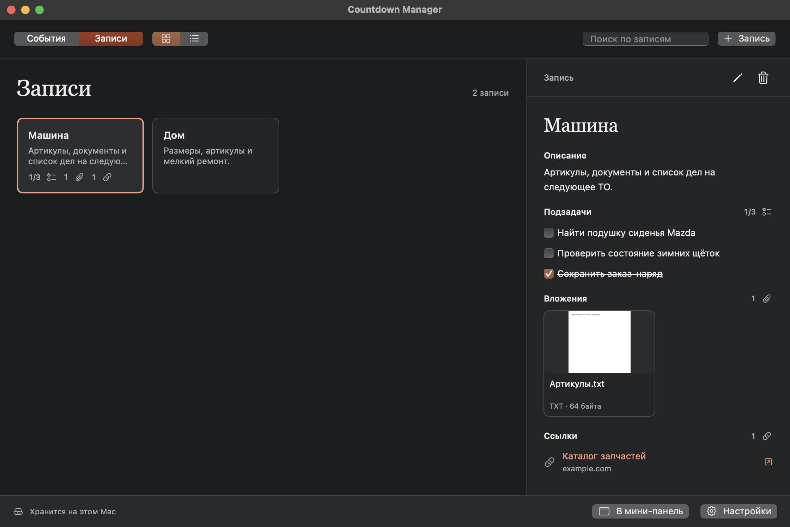
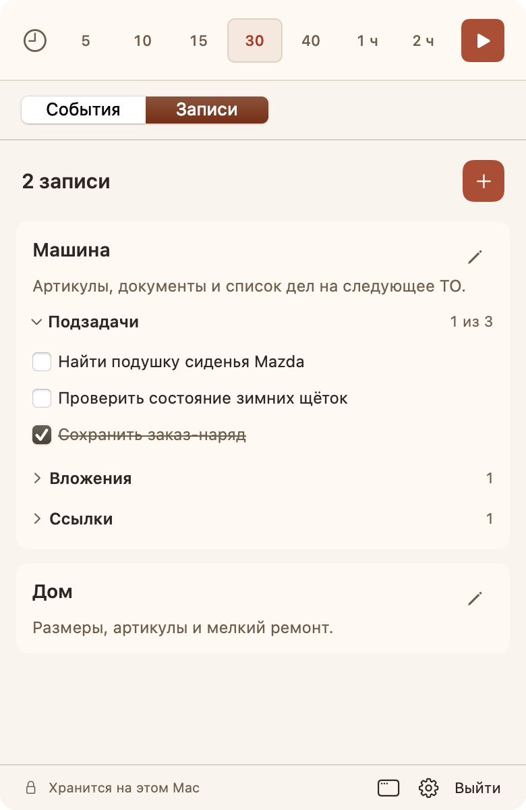

# Countdown Manager

Нативное приложение для macOS с событиями с датой, бессрочными записями и таймером.
Большое окно и мини-панель в строке меню работают с одними данными. События, записи и
локальные вложения доступны без интернета и учётной записи. Опциональный прогноз погоды
требует сети.

**1.28.0 · сборка 53 · Apple Silicon · macOS 13+.**
Язык по умолчанию — английский. Выберите **Settings → Language → Русский**,
чтобы переключить интерфейс.

[Скачать последний выпуск](https://github.com/MonolitST/CountdownManager/releases/latest) · [Что изменилось](docs/releases/v1.28.0-notes.md) · [Проверки выпуска](docs/releases/v1.28.0.md)

## Как выглядит приложение

Раздел «Записи» в большом окне и мини-панели на демонстрационных данных.




[Как получены снимки](docs/images/v1.28.0/PROVENANCE.md)

## Установка и обновления

Публичная сборка рассчитана на Mac с Apple Silicon и macOS 13 или новее.
Откройте [последний релиз](https://github.com/MonolitST/CountdownManager/releases/latest),
скачайте ZIP, распакуйте и перенесите `Countdown Manager.app` в «Программы».
Сборка подписана ad-hoc, без нотарификации Apple; при первом запуске может потребоваться
разрешение в «Системные настройки → Конфиденциальность и безопасность».

В установленном приложении: **Настройки → Проверить обновления…**. Автопроверку можно
выключить, сохранив ручную. ZIP и канал Sparkle подписываются Ed25519; приложение
проверяет подпись до распаковки. Редактор, работающий таймер и незавершённая запись
откладывают перезапуск. «Вернуться к работе» сохраняет сеанс; установка готового
обновления запускается отдельной командой после повторной проверки.

Открыть описание текущего выпуска снова: **Настройки → Что нового…**.

## Быстрый старт

1. Нажмите значок Марса в строке меню. В пустом списке выберите **«На сегодня»**,
   **«На завтра»** или **«Выбрать дату»**; для обычного события нажмите **+**.
2. Укажите название и сегодняшнюю или будущую дату. При желании добавьте заметку,
   значок, подзадачи, файлы и ссылки, затем нажмите **«Сохранить»**.
3. Нажмите звезду, чтобы сделать событие основным. Оно появится первым и займёт строку
   меню. Повторное нажатие снимает выбор; без основного все карточки обычные,
   а в строке меню остаётся Марс.
4. Кнопка окна внизу мини-панели открывает большое окно. Доступно также меню
   **Окно → Открыть основное окно** (`Command-0`).

Чтобы подготовить несколько дней, выберите **«Создать день → До конца недели…»**.
В мини-панели этот вариант находится под действиями для одного дня и доступен также
в пустом списке. В воскресенье он меняется на **«На следующую неделю…»**.
Проверьте даты и нажмите **«Создать N дней»**; открытие списка и **«Отмена»** ничего
не сохраняют.

Для копирования нажмите значок двух листов **«Создать копию…»**. В мини-панели он находится
рядом с карандашом карточки, в большом окне — между карандашом и корзиной выбранного события.
Откроется подготовленный черновик с фокусом на дате. Будущая дата источника сохраняется,
даже если это 15 сентября 2044 года. Для сохранённого прошедшего события предлагается сегодня.
Можно выбрать сегодня или любую будущую дату, поправить содержимое и нажать **«Сохранить»**.

Копия наследует название, заметку, значок, ссылки, файлы, подзадачи, погоду и сохранение после
даты. Все её подзадачи становятся невыполненными, избранное по умолчанию выключено.
Автоматическое название дня следует выбранной дате. Файлы получают независимые локальные
копии при сохранении. **«Отмена»** отбрасывает черновик. Сохранённое исходное событие остаётся
доступным со своим содержимым.

Нажатие на значок открывает или закрывает мини-панель. На macOS 27 и новее значок остаётся
подсвеченным до закрытия, а панель появляется и исчезает плавно. «Уменьшение движения»
отключает переходы. При переходе в другое приложение или Space панель скрывается.
Следующее открытие возвращает тот же
список или черновик с сохранённой позицией. `Command-W` скрывает панель. Выход из приложения
может сбросить несохранённый черновик. После первого открытия большого окна значок Dock
остаётся до выхода из приложения.

## События и дни

- Несколько событий на одну дату разрешены. Дни считаются по календарю, а не по 24 часам.
- Карточка показывает точную дату и **«Сегодня»**, **«Завтра»**, **«Через N дней»**;
  у сохранённых прошедших событий — **«Вчера»** или **«N дней назад»**.
- В большом окне есть сетка, лента, поиск и детали. События сгруппированы по месяцу
  и году; прошедшие находятся после будущих, а выбранное основное остаётся первым.
- Поле **«Поиск по событиям»** ищет по названиям, заметкам, подзадачам, именам файлов,
  названиям и адресам ссылок. Если совпала подзадача, файл или ссылка, в карточке виден один
  фрагмент с терракотовой подсветкой. Справа доступны детали события.
- Действие **«Создать день»** заполняет название днём недели. Пока включено
  **«Название по дате»**, перенос даты обновляет его даже после сохранения.
  Ручной ввод включает своё название; действие рядом с полем возвращает автоматическое.
- **«До конца недели…»** создаёт дни с завтрашнего по воскресенье: в четверг — три,
  в субботу — один. В воскресенье **«На следующую неделю…»** предлагает семь дней,
  с понедельника по воскресенье. Дата пропускается, если на неё уже сохранено любое событие.
  Проверяются день, месяц и год. Название, способ создания и подзадачи на это не влияют.
  Существующее событие сохраняется со всем содержимым. Набор новых дней сохраняется
  одной записью, без частично созданной недели при ошибке. Если дата изменилась во время
  просмотра, обновлённый список нужно подтвердить повторно.
- Новая заметка сохраняется до 150 пользовательских символов. Более длинный текст
  вставляется целиком: счётчик краснеет, «Сохранить» доступно после сокращения. Старые
  длинные заметки сохраняются без обрезания; после сокращения действует новый сохранённый предел.
- Дополнительный значок выбирается из встроенного каталога и может быть очищен.
  Старый календарный emoji не дублирует календарный листок в карточках.

По умолчанию событие удаляется после окончания своей даты вместе с подзадачами,
ссылками и принадлежащими приложению копиями файлов. Флажок **«Сохранять после даты
события»** оставляет всё это доступным. Звезда сама по себе сохранение не включает.
Снятие флажка у уже прошедшего события требует подтверждения удаления.
Исходные файлы вне хранилища приложения не удаляются.

Изменения редактора записываются только после **«Сохранить»**; **«Отмена»** отбрасывает
черновик. Общий редактор может быть открыт только на одной из двух поверхностей.

## Записи

В мини-панели и большом окне есть отдельный раздел **«Записи»**.
В записи можно хранить описание, подзадачи, ссылки и файлы без даты. Нажмите
**«Создать запись»** в пустом разделе или **+**. В мини-панели кнопка стоит в заголовке
списка справа от счётчика записей. Новые записи появляются сверху,
а редактирование и отметки подзадач сохраняют порядок. Запись остаётся доступной до
ручного удаления. В большом окне поиск работает внутри открытого раздела.

## Подзадачи и материалы

На событие или запись можно создать до **10 подзадач** и добавить до **15 файлов**.
Чек-лист показывает прогресс, группирует незавершённые дела перед выполненными и
помнит свёрнутое состояние. Выполнение всех дел не удаляет событие и не меняет дату.

Можно перетаскивать строки подзадач вверх и вниз в пределах
своей группы в большом окне и раскрытой мини-панели. Соседние строки освобождают место
во время движения. Отпускание в группе сохраняет порядок, отпускание за её пределами
возвращает строку обратно.
Редактор показывает подзадачи в том же порядке, что и карточка. Новая строка
появляется в конце группы невыполненных дел.

У невыполненной подзадачи события справа доступна стрелка
**«Перенести на другой день»**. Нажмите её, выберите сегодняшнюю или будущую дату и
событие-получателя, затем нажмите **«Перенести»**. Сначала предлагается завтра.
Выбор раскрывается прямо под пунктом в мини-панели и в деталях большого окна.
Если на дату ещё нет событий, будет создан день с названием по дате. При нескольких
событиях выберите нужное. В получателе должно быть место в пределах 10 подзадач.
**«Отмена»** закрывает выбор. Переносится один выбранный невыполненный пункт.
Строка сохраняет размер при появлении и скрытии стрелки.
Исходное событие продолжает действовать по своему правилу сохранения после даты.

В редакторе можно выбрать файл любого формата, в том числе PDF или ZIP.
Файлы, веб-ссылки и текст можно перетащить на карточку
события или записи либо в её детали в большом окне. Для мини-панели поднесите материал
к значку в строке меню, дождитесь открытия панели и бросьте его на нужную карточку.
Приложение создаёт локальные копии, не перемещая исходники. Первые файлы видны на
полке превью; **«Показать все N»** открывает список с поиском.

Можно перетащить свежую миниатюру скриншота macOS на карточку.
Изображение становится обычным локальным вложением без перекодирования приложением.

Клик по файлу открывает встроенный нативный просмотр. Кнопки и клавиши **← / →**
переключают все файлы карточки без зацикливания. **«Открыть в приложении»** передаёт
файл системному приложению. Доступность превью зависит от формата и macOS;
видео автоматически не воспроизводится.

Веб-ссылки можно сохранить отдельно от файлов. Текст из буфера вставляется через
контекстное меню **«Вставить текст как вложение…»**: перед созданием TXT можно
проверить текст и имя. Исходный файл вне хранилища приложения при этом не удаляется.

## Таймер и строка меню

В приложении один таймер: **5, 10, 15, 30, 40, 60 или 120 минут**. Он находится
над событиями в мини-панели; состояние общее для обоих интерфейсов.
Во время отсчёта доступны остаток времени и удаление. Паузы и продления нет.

Завершение сопровождается звуком и собственным окном приложения на пять секунд;
клик закрывает окно без удаления завершённого таймера. В строке меню будильник
продолжает сигнализировать до удаления. «Уменьшение движения» заменяет покачивание
пульсацией, а значок в окне завершения делает неподвижным.
Абсолютный срок сохраняется между запусками.

Таймер временно занимает строку меню. После удаления возвращается основное событие
со своим значком или монохромным календарём и отсчётом; без основного — Марс без текста.

## Настройки и погода

Настройки доступны из обоих интерфейсов. Здесь находятся оформление, автозапуск,
автопроверка обновлений, погода, режим **«Не давать Mac и экрану засыпать»**,
проверка обновлений, **«Что нового…»** и **«Сохранить диагностику…»**.
Внизу отображается версия запущенного приложения.

Режим без сна сохраняет выбранное состояние между запусками и действует, пока
приложение работает. Он не отменяет ручной сон, блокировку, закрытие крышки или
защиту при низком заряде. При ошибке macOS интерфейс предлагает повторить действие.

Для прогноза включите **«Показывать погоду в днях»**, выберите автоматическое
местоположение или город, затем включите **«Показывать погоду для этого дня»**
у нужного события. У нового дня этот флажок уже включён. Геолокация запрашивается
при явном действии; при её недоступности можно выбрать город вручную.

Open-Meteo, MET Norway и wttr.is запрашиваются параллельно. Показывается медиана
пригодных дневных максимумов в °C; горизонт запроса — до 16 дней, включая сегодня.
Если на дату нет пригодного прогноза, погодного элемента просто нет. Временные ошибки
вызывают ограниченные повторные попытки. Доступность сервисов и работа через любой
VPN не гарантируются; прогноз и координаты удерживаются в памяти без дискового кэша.

## Данные и диагностика

События хранятся локально:

```text
~/Library/Application Support/CountdownManager/countdowns.json
```

Копии файлов находятся в `Attachments` рядом с JSON. Настройки, в том числе срок
таймера, сохраняются отдельно. Для резервной копии сохраняйте JSON и каталог
вложений вместе. Более старые версии могут потерять новые поля при записи;
откат не равнозначен совместимому чтению.

Записи хранятся рядом в `records.json`, их файлы — в `RecordAttachments`. Для резервной
копии записей сохраняйте оба этих объекта вместе.

Погода отправляет координаты поставщикам прогноза; данные событий и файлы им
не передаются. Автообновление обращается к GitHub. Учётной записи и облачной
синхронизации событий у приложения нет.

**«Сохранить диагностику…»** создаёт локальный ZIP с технической сводкой и журналами.
Названия событий и записей, описания, тексты подзадач, пользовательские URL и координаты в него
не включаются. Отправка остаётся ручной. Журнал находится в каталоге `Logs` рядом
с данными; текущая и предыдущая части ограничены 512 КиБ каждая.

## Сборка и проверки

Нужны Git и Apple Command Line Tools либо Xcode.

```sh
git clone https://github.com/MonolitST/CountdownManager.git
cd CountdownManager
./build.sh
open "Countdown Manager.app"
```

Сборка идёт под архитектуру текущего Mac. Обычный `build.sh` создаёт локально
подписанное приложение с выключенным автообновлением; подписанный канал задаётся
при подготовке релиза.

Тексты приложения хранятся в каталогах [English](Sources/CountdownCore/Resources/en.lproj/Localizable.strings)
и [Русский](Sources/CountdownCore/Resources/ru.lproj/Localizable.strings). Системные пояснения
разрешений находятся в соседних `InfoPlist.strings`. Сборка переносит обе локализации в пакет приложения.

Продуктовые фичи и исправления разрабатываются в отдельных ветках от `main`, затем
после проверок включаются в `main`. Самостоятельное сопровождение скиллов, харнеса,
инструментов и документации идёт сразу в `main`. Связанные с фичей тесты и документация
остаются в её ветке до слияния.

Решение о релизе владелец принимает отдельно: слияние фичи выпуск не запускает.
Все релизы собираются из `main` и получают тег версии. После завершения фичи и её
согласованного включения в проект рабочая копия возвращается на актуальную `main`.
Полные правила — в [AGENTS](AGENTS.md#git-workflow).

```sh
swiftlint lint --config .swiftlint.yml --strict --no-cache
./verify.sh fast       # CoreChecks, UIChecks, контракт оформления и локализация
./verify.sh ui         # мини-панель, редактор и сохранение сеанса
./verify.sh desktop    # большое окно и общее состояние
./verify.sh attachments
./run-xcui-tests.sh    # внешний macOS XCUITest; нужен полный Xcode
```

Выбирайте проверки по изменённому поведению, а не по количеству прогонов.
По умолчанию выполняйте точечную приёмку изменённого сценария и непосредственно связанных
рисков. Расширенный ручной прогон с матрицей, обратными переходами и регрессиями запускается
по отдельной явной просьбе владельца, например «ручное тестирование с регрессами».
В этом режиме сначала самостоятельно продумайте случаи и ожидаемые результаты, затем пройдите
каждый через интерфейс и зафиксируйте результат либо конкретное ограничение проверки.
Перед выбором проверьте ожидания и тестовые данные: они должны соответствовать текущему
контракту и обнаруживать нужный дефект. Полезные проверки старых ошибок сохраняются;
устаревшие ожидания обновляются вместе с согласованным поведением. Пересечения команд
и правила выбора описаны в [VERIFICATION](docs/VERIFICATION.md).

Команда **«нужно независимое ревью»** запускает отдельного приёмщика со свежим контекстом.
Он проверяет результат задачи и возвращает замечания с уровнем серьёзности, способом
воспроизведения и критерием исправления. См. [скилл независимого ревью](.agents/skills/independent-review/SKILL.md).

Нативные сценарии работают на отдельных профилях без пользовательских данных.
Снимки подтверждают вид, но не заменяют проверку системных взаимодействий.

## Документация проекта

- [PRODUCT](docs/PRODUCT.md) — поведение и ограничения продукта.
- [DESIGN](DESIGN.md) — текущий нативный визуальный язык.
- [ARCHITECTURE](docs/ARCHITECTURE.md) — устройство и владельцы состояния.
- [VERIFICATION](docs/VERIFICATION.md) — команды проверок и границы доказательств.
- [UPDATES](docs/UPDATES.md) — подготовка и публикация подписанного обновления.
- [AGENTS](AGENTS.md) — правила работы в репозитории и проектные навыки.
- [Countdown Release](.agents/skills/countdown-release/SKILL.md) — единый порядок выпуска и завершения релиза.
- [Agent evals](evals/README.md) — отдельные проверки поведения агента.
